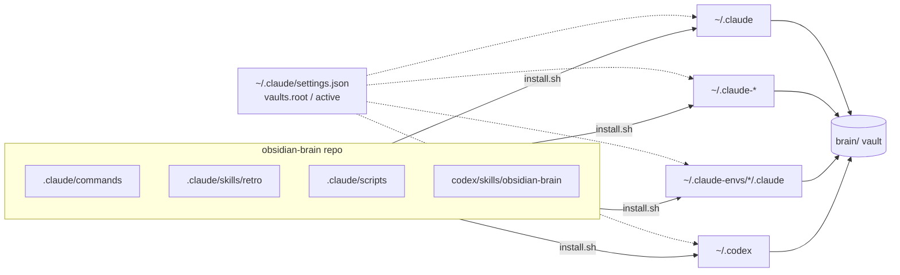

# Obsidian Brain — AI Memory System via Obsidian

A persistent memory layer shared by Claude Code, Codex and other local agents, stored as plain Markdown in one Obsidian vault.

- **One vault, many agents** — every Claude config and Codex read and write the same `brain/` folder.
- **Hub-and-spoke graph** — `global.md` → class hubs → project hubs → sessions, documents, notes.
- **Curated, not logged** — only decisions, verified outcomes and open work are saved; never raw transcripts or secrets.
- **Manual recall** — nothing loads until you run `/memory` or `/recall`, so token cost stays predictable.

Setup: [SETUP.md](SETUP.md) · Commands and workflows: [USAGE.md](USAGE.md)

---

## How it fits together



| Part | Where it lives | Role |
|---|---|---|
| Claude commands | `.claude/commands/*.md` | `/memory`, `/save-session`, `/recall`, … |
| Claude skill | `.claude/skills/retro/` | Periodic retrospective over recent sessions |
| Hooks | `.claude/scripts/*.sh` | Stop hooks: unprocessed originals, unsaved session reminder; prompt hook: switch the active project by folder |
| Codex skill | `codex/skills/obsidian-brain/` | Same vault rules for Codex |
| Codex rules | `codex/AGENTS.md` | Section appended to `~/.codex/AGENTS.md` |
| Vault config | `~/.claude/settings.json` → `vaults` | Single source of `root`, `active`, `aliases` for all agents |
| Templates | `vault-template/`, `project-template/` | Skeleton for a new vault |

---

## Vault structure

```text
brain/                                  ← open this folder in Obsidian
├── global.md                           ← single entry point, links to classes
├── classes/<class>.md                  ← groups of projects (client-products, games, …)
├── projects/
│   ├── <project>.md                    ← project hub = core memory + index
│   ├── <project>/
│   │   ├── <sub-project>.md            ← nested hub (parent: [[projects/<project>]])
│   │   ├── sessions/   (+ archive/)
│   │   ├── documents/originals | processed
│   │   └── notes/
│   └── …
└── _global/                            ← cross-project memory, rules, templates
    ├── notes/  sessions/  documents/
    └── templates/
```

Links only go **down** the tree: `global → class → project → content`. Content notes link back to their own hub through `related:`.

### Hub file

Each hub (`projects/<project>.md`) is both core memory and index. `/memory` loads it, `/save-session`, `/note` and `/ingest` append to it.

```markdown
---
id: <project>
type: hub
class: <class-id>
domain: <domain>
stage: discovery | prototype | active | operational
engagement: internal | client | education | personal
updated: YYYY-MM-DD
---

## Project / State / Key decisions / Open questions / Load if needed
---
## Sessions / Documents / Notes / Context blocks / Archived
```

Everything above `---` is memory curated by you. Everything below is the index rebuilt by `/index`.

---

## Memory model

| Brain mechanism | System equivalent |
|---|---|
| Attention filter | `/save-session` and `/ingest` keep decisions and facts, not transcripts |
| Working memory | The active context window |
| Hippocampus (pointers) | Hub index sections: one line + summary per note |
| Spreading activation | `/recall` loads matches and names their `related` links without loading them |
| Consolidation | `/consolidate` turns old sessions into patterns in the hub and archives them |
| Context-dependent retrieval | Active project ranks above `_global` at equal relevance |

### Loading tiers

| Tier | What | When |
|---|---|---|
| 0 | Class hub + project hub | `/memory` |
| 1 | Hub index lines | `/recall` scoring |
| 2–3 | Matched sessions, documents, notes | `/recall` match or explicit request |

Hub memory section budget: **≤ 1 500 tokens**. `/consolidate` moves overflow to `memory/context/<topic>.md`.

---

## Commands

| Command | What it does |
|---|---|
| `/memory [global]` | Load class + project hub (or `global.md`) |
| `/save-session` | Save goal, decisions, outcomes, open questions; append to hub |
| `/recall <query>` | Score hub indexes, load top 5 matches, list linked notes |
| `/note <text>` | Save a condensed note to `notes/` |
| `/idea <text>` | Save a passing idea to `_global/ideas/` (the Mountain of Ideas) |
| `/ingest <file\|url>` | Store original, write processed summary with key facts |
| `/add-vault --root <path>` | Initialize a vault |
| `/add-vault <name> --class <id>` | Create a classified project and make it active |
| `/switch-vault <name\|path>` | Change `vaults.active` |
| `/index [global]` | Rebuild hub index sections from frontmatter |
| `/consolidate [global]` | Compress sessions older than 90 days into hub patterns |
| `/retro [7d\|since DATE]` | Review recent sessions; propose memory, rule, skill and hook updates |

Codex uses the `obsidian-brain` skill with natural requests: "запиши це в Brain", "знайди в Brain усе про …", "збережи сесію".

---

## Note frontmatter

```yaml
---
id: <project>/<type>/<project>-<date>-<slug>
type: session | document | note | hub | class
date: YYYY-MM-DD
project: <project>
tags: [kebab-case]
status: active | archived
related:
  - "[[projects/<project>]]"
summary: "One sentence — used by indexes and /recall"
source: "<file or URL>"    # documents only
---
```

`summary` is mandatory: indexes render it and `/recall` scores it first.

---

## Hooks

| Hook | Script | Fires when |
|---|---|---|
| Stop | `check-originals.sh` | A file in `documents/originals/` has no processed note |
| Stop | `remind-save-session.sh` | The active project has no session saved today |
| UserPromptSubmit | `auto-switch-vault.sh` | The session's folder is listed in a project hub's `workdirs`; that project becomes active |

The Stop hooks read `~/.claude/settings.json`; a project `.claude/settings.json` overrides it only when its `vaults.active` is non-empty. Both need `jq` and exit silently without it.

`auto-switch-vault.sh` needs `python3`. It reads `workdirs: ["~/code/app", …]` from hub frontmatter, picks the deepest folder that contains the session's working directory and writes `vaults.active`; an unmapped folder or a project with its own `vaults.root` changes nothing. `/switch-vault` still works there. Two sessions in different projects take turns: each prompt sets its own project first.

---

## Settings

```json
{
  "vaults": {
    "root": "/abs/path/brain",
    "active": "/abs/path/brain/projects/client/sdk",
    "aliases": {
      "global": "/abs/path/brain/_global",
      "sdk": "/abs/path/brain/projects/client/sdk"
    }
  }
}
```

- Hub of the active project: `{active}.md`
- Wikilinks are vault-relative: `[[projects/client/sdk/sessions/…]]`

---

## Sync

The vault is a plain folder and can be its own private Git repo. Agents never commit or push it unless you ask. Obsidian Sync can run alongside Git.

---

## Design principles

- One canonical note per topic: update it instead of creating duplicates.
- Hard size limits on hubs: overflow goes to context blocks.
- Originals are stored once and never modified.
- Plain Markdown: everything works without AI tools or Obsidian.
- The user drives recall depth; links are offered, never auto-loaded.
