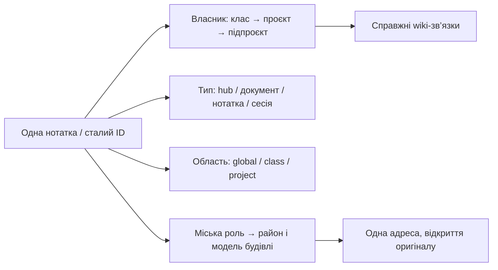

# Brain City · категоризація Brain

Рішення 2026-10-24: зберегти дерево власників і додати незалежну міську проєкцію.

## Загальна бібліотека знань · 2026-10-25

Хаб `_global/library.md` володіє загальним фондом `_global/library/articles/`, `documents/` і `notes/`; це окрема гілка поза проєктами. Поля матеріалу: сталий `id`, `type: article / document / note`, `knowledge_scope: library`, предметна категорія `domain`, `source_url` за наявності, `related: ["[[_global/library]]"]`. Проєктного власника немає; використання матеріалу проєктом задається wikilink або `applies_to`.

У місті фонд розміщений у публічній бібліотеці цивільного центру: `knowledge-library` для hub і `library-item` для матеріалу. Файли мають власні ID, URI та записи каталогу, але ділять фізичний корпус `grand-library`; до 48 записів у корпусі, з додатковим обмеженням ресурсів кварталу. Переповнення створює наступний корпус; адреси наявних записів не перераховуються. Це параметр нашої проєкції, не реальна бібліотечна норма.

Проєктні документи, сесії та глобальні правила залишаються у своїх власників. Навіть помилкове `knowledge_scope: library` у проєктному документі не забирає його з проєкту. Предметна тема бібліотечного матеріалу не створює новий клас проєктів або новий район: чинні геометрія й кластери збережені. Кнопка бібліотеки відкриває каталог; пошук знаходить кожен матеріал, а безпечне HTTP(S)-посилання відкриває першоджерело.

## Поточна схема v8 · 2026-10-25

| Вимір | Значення |
|---|---|
| Власник | Початковий `class`, `domain` і найближчий project-hub збережені |
| Тема | Явне `city_topic` на кожному з 18 project/org hubs; підпроєкт успадковує тему батька, якщо не визначає власну |
| Центр | `city_anchor: true` на одному проєкті кожної теми; `global.md` — civic; class-хаби тепер реєстри організаційної класифікації |
| Значущість | `importance: core / reference / supporting / history`; hubs, канонічні огляди й current-state — core; documents — reference; звичайні notes — supporting; sessions — history |
| Житло | Низькопріоритетні сесії точного проєкту ділять до 8 квартир у будинку; одиниці адреси, мешканці й ресурси зберігаються окремо |
| Проєктна пам’ятка | Кожен project/org hub отримує тематичну споруду (`city_landmark`, функція з `city_subject` або типова для теми); у темах з комплексом це прибудова комплексу кластера (BC-72), інакше — окрема споруда; `city_landmark: none` скасовує її, а вже збудована знімається без руху будинків (2026-10-25: evamo — `city_subject: lubrication`, newstream — лабораторія спортивної науки) |
| Забудова | Основні документи — окремі маєтки або тематичні корпуси; житлові записи — багатоповерхівки; службові об’єкти не створюють нотаток |

| Тема | Проєкти | Спільна інфраструктура |
|---|---|---|
| Спорт | Newstream і всі його підпроєкти | Стадіон і тренувальний центр |
| Наука | EVAMO: прикладне машинне бачення та вимірювання; ML-освіта ХПК | Науковий кампус |
| Технології | Claude Brain, Air Alert, Lab Track | Технологічний центр |
| Енергетика | Solar Panel HPFK, Light Bot | Енергетичний центр |
| Медіа | Linza | Медіацентр |
| Ігри | Mali Radosti | Творчий центр |
| Управління | Глобальні ноди, протоколи, реєстри | Ратуша, рада, архів |

Lab Track — програмне забезпечення обліку, тому належить до технологій; навчальні матеріали ML належать до науки. Newstream використовує ML, але його предметна область — спорт. Це явна предметна категоризація, а не кластеризація за випадковими словами.

Стадіон 165 × 125 м, кампус 115 × 95 м та енергетичний центр 85 × 65 м займають окремі захищені території з реальними підходами, owner-проєктом, місткістю, годинами й візитами. Ратуша — справжній `global.md` у корпусі 26 × 14 м на центральній площі; перенесення зберігає ID та зв’язки, не створює копії джерела й не рухає інші будинки. Резервування та одноразова адаптація — `simulation/landmarks.py`. Планування, матеріали, розміри комплексів, 6 поверхів і 8 квартир — параметри нашого сценарію, не містобудівні нормативи. Нижче — історія v7; вона не скасовує поточну таблицю.

## Підстава й межі дослідження

| Джерело | Підтримує | Наш висновок |
|---|---|---|
| [W3C SKOS Reference, §8–9](https://www.w3.org/TR/skos-reference/) | Окремі ієрархічні й асоціативні відношення, іменовані колекції | Не перетворювати візуальну групу на нового власника файла |
| [W3C SKOS Primer, §2.5, §4.1](https://www.w3.org/TR/skos-primer/) | Схеми понять і колекції; поняття може належати до кількох схем | Проєктна належність сумісна з міською адміністративною роллю |
| [Obsidian Properties](https://obsidian.md/help/properties) | Структуровані YAML-поля й посилання | `knowledge_scope` та `city_role` додаються без переміщення нотаток |
| [Obsidian Aliases](https://obsidian.md/help/aliases) | Альтернативні назви з посиланням на один канонічний файл | Будівля не створює копію глобальної ноди |

Ці джерела підтримують спосіб моделювання, а не доводять перевагу конкретної структури особистого vault. Міські назви й коефіцієнти — наш дизайн. Підстав переносити всі файли в нове дерево немає: поточний ownership уже узгоджений, а змішування міської функції з проєктом втратить інформацію.

## Правила всього каталогу

| Джерело | Власник / область | Місто |
|---|---|---|
| `global.md` | global | Ратуша — один реальний джерельний будинок |
| `AGENTS.md`, спільні agent-протоколи | global | Рада правил |
| `_global/templates*` | global | Палата реєстрів |
| `_global/retro*`, `_global/sessions/*` | global | Міський архів |
| Спільні map-конвенції | global | Бюро планування |
| Інші `_global/*` | global | Управління спільною інфраструктурою |
| `classes/*.md` | відповідний клас | Районна управа, основна нода району |
| Top-level project/org hub | відповідний проєкт | Штаб проєкту / організації |
| Nested project hub і його матеріали | найближчий hub, успадкований class | Підкластер усередині організації; точний власник збережений |
| Правила окремого проєкту | цей проєкт | Проєктна рада у своєму районі |
| Проєктні documents / notes / sessions | цей проєкт | Бібліотеки / будинки / проєктний архів |
| Brain City rules, urbanism, canonical city note | Claude Brain, project scope | Міська рада / бюро планування, зі збереженим проєктним власником |

Явне `city_role` має пріоритет над дефолтом за шляхом. Дозволені civic-ролі: `town-hall`, `council`, `registry`, `city-archive`, `planning-office`, `infrastructure-office`. `knowledge_scope` не переводить локальні правила до глобальних автоматично. Шаблони класифікуються як джерела-шаблони; їхні placeholder-class не створюють райони.

## Просторовий контракт

| Механізм | Нова поведінка |
|---|---|
| Початок міста | `global.md` першим засновує civic-район біля площі |
| Основні ноди | Class-хаби перед project-хабами, незалежно від degree |
| Клини | Civic першим; інші за розміром на момент планування; точне покриття 360°; межі зберігаються між звичайними правками |
| Квартали | Центр нового кварталу у своєму клині; ріст поряд зі своїм районом, включно з придатним мостом через річкову петлю |
| Великі проєкти | Власні підклини та квартали; nested owner не втрачається через спільну top-level проєкцію |
| Контроль | Кожен район / підрайон окремо: пороги, компоненти, anchors, historical assignments; загальна частка не приховує локальний провал |
| Стан | Одноразова перебудова v7 за прямим запитом; старий стан збережений у backup; далі сталі адреси |

Окремі каталоги, звіти, карти та експорти створюються лише на пряме прохання користувача. Машинний стан перевірок застосунку не є другим канонічним vault.
