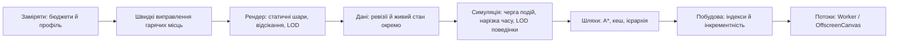

# Brain City · оптимізація

> 2026-10-25: 2D-рендер видалено (лише 3D, див. [RENDER-3D.md](RENDER-3D.md)). Розділи про Canvas-шари, LOD і кеш спрайтів `details.js` — історія; чинні заміри 3D — у RENDER-3D.md.

Дослідження й план від 2026-10-25 на прохання користувача: оптимізувати місто як гру — рендер, шляхи, об’єкти, симуляцію, дані.

**Статус:** етапи 0–4, 6 і 7 впроваджені й виміряні 2026-10-25 (розділ 0); етапи 5 і 8 свідомо відкладені з цифрами нижче. Кожен етап закривається замірами з цього документа й тестами правил; швидкість не може порушити правду Brain, сталі адреси, детермінізм (BC-34) і аудит.

## 0. Результати впровадження · 2026-10-25

Після загальної бібліотеки виконано новий повний прогін: 96 тестів, 71/71 правило; 100 / 1 000 / 10 000 джерел без помилок аудиту. Останній окремий замір 10 000: побудова 22,426 с, крок 12,8 мс. Таблиця нижче зберігає порівняння оптимізації до / після на попередній редакції; ці цифри не слід подавати як новий замір великих комплексів у браузері. Кешований шар, розділення static/live та тести `test_render_layer.js` збережені. Корпуси бібліотеки використовують спільні фізичні будівлі та чинний статичний шар; каталог не створює окремого будинку для кожної статті.

Повторний `precincts.sync` на реальному Brain (152 джерела): ~43 мс → медіана 0,0101 мс, без зміни умов. Невдалі спроби зберігаються разом зі світом; повтор запускають лише геометрія, попит або бюджет. Це виграш при завантаженні/синхронізації, не щокадровий. Контрольний замір 1 000 джерел до / після кешу: побудова 0,777 / 0,772 с, крок 0,53 / 0,52 мс; оглядовий JS-кадр 0,86 / 0,85 мс. Такі малі різниці — шум; кеш не прискорює звичайний кадр. Після річки v9: 0,809 с, крок 0,51 мс, огляд 0,92 мс; це JS проти лічильного canvas, не FPS.

Заміри до / після тими самими інструментами: `python3 city/benchmark.py` (без профайлера) і `node city/bench_render.js` (JS рендера проти лічильного canvas, без растеризації браузера).

| Метрика | До | Після | Ціль |
|---|---|---|---|
| JS кадру, реальний Brain (152) | 16,6 мс, 81 тис. викликів canvas | 3,9 мс, 31 тис. | ≤ 4 мс ✓ |
| JS кадру в огляді, 3 000 | 128 мс, 679 тис. | 0,9 мс, 2 тис. | ≤ 8 мс ✓ |
| JS кадру крупно, 3 000 | 69 мс, 361 тис. | 3 мс, 21 тис. | ≤ 8 мс ✓ |
| Повна перебудова статичного шару, 3 000 | щокадру | 58 мс перший кадр, 57 мс після зуму, лише при зміні масштабу / режиму / фільтра / геометрії | ≤ 150 мс ✓ |
| `fromWorld`, 3 000 | 487 мс кожні 5 с | 31 мс лише при новій ревізії геометрії | ≤ 20 мс — майже |
| Дані кожні 5 с, 3 000 | 3,4 МБ | 12 КБ живого стану gzip (49 КБ сирих); геометрія 1,2 МБ gzip (3,3 МБ) лише при зміні ревізії, інакше 304 | ≤ 50 КБ ✓ |
| Дані, реальний Brain | 225 КБ геометрії + 27 КБ живого | 76 КБ + 7,7 КБ (gzip) | — |
| Крок логіки, 3 000 / 10 000 | 5,1 / 78 мс | 1,6 / 9,3 мс | ≤ 10 мс ✓ |
| Побудова, 1 000 / 3 000 | 1,3 / 5,7 с | 0,7 / 3,0 с | — |
| Побудова, 10 000 | 72,9 с | 19,0 с (`verify_simulation.py`: 71/71 правил, 0 помилок аудиту) | ≤ 20 с ✓ |

| Етап | Що зроблено | Де |
|---|---|---|
| 0. Заміри | `benchmark.py`: побудова, крок, `presentation`, розміри static / live; `bench_render.js`: `fromWorld`, перший кадр, огляд, панорамування, зум, перебудова, крупний план, виклики canvas | `city/benchmark.py`, `city/bench_render.js` |
| 1. Швидкі виправлення | Рівномірна сітка для лавок у `fromWorld` (було O(лавки × об’єкти)); кеш `tint`; годину доби рахувати раз на тік; стан закладу — на запит, а не перезапис усіх закладів щотіку; індекс пам’ятних місць району; навантаження кварталу — раз на розподіл | `web/city-plan.js`, `web/app.js`, `simulation/activities.py`, `simulation/economy.py`, `simulation/engine.py` |
| 2. Рендер шарами | Статичний шар (земля, вулиці, будинки, дерева, ліхтарі) в offscreen canvas із запасом 25% на панорамування; dirty-ключ: ревізія плану, масштаб, режим, фільтр, пошук, виділення, розмір; під час зуму — масштабована копія, перебудова через 160 мс; кліки по кешованих об’єктах зі зсувом копії; будинки, що стоять перед мешканцем і перекривають його, перемальовуються поверх у порядку глибини; збій кадру записується в `data-render-error` і не зупиняє цикл | `web/app.js`, `web/details.js` (`setContext`), `tests/test_render_layer.js` |
| 3. LOD | Нижче масштабу 0,4 — без дверей, маркіз, лиштв, труб; ліхтар — стовп і світло; нижче 0,3 перекриття мешканців не перемальовуються (люди — точки); фасади вже мали поріг 0,55 | `web/app.js`, `web/details.js` |
| 4. Дані | `/api/world/static` з ETag = ревізія геометрії й 304; `/api/world/live` — тік, видимі мешканці (лише 8 наступних вузлів маршруту, координати до 1 см), човники; `/api/city` з ETag і 304; сервер кешує JSON геометрії за ревізією і стискає відповіді ≥ 1 КБ gzip (рівень 1), якщо клієнт приймає; клієнт перебудовує план лише при новій ревізії | `simulation/engine.py` (`static_revision`, `static_presentation`, `live_presentation`), `preparation.py`, `server.py`, `web/app.js`, `tests/test_server.py` |
| 6. Шляхи | A* з евклідовою евристикою (послідовна нижня межа, довжини маршрутів незмінні) | `simulation/network.py` |
| 7. Побудова | Кеш історичних радіалів (`_historic`, 222 тис. викликів з хешуванням); пошук вузла для зварювання без сортування на кожен виклик (той самий вибір); відсікання відрізків вулиць за обмежувальним прямокутником при відступі будинку (точна необхідна умова); `warp` кешується (`lru_cache`, чиста функція сталих параметрів); `overlapping` — бінарний пошук по межах секторів замість перебору; у `can_allocate` спершу дешева перевірка місткості, потім маршрут. Хеш `presentation()` на 1 000 джерел до / після однаковий | `simulation/world.py`, `simulation/network.py` |

**Відкладено з причиною:**

| Етап | Чому не зараз | Що спостерігати |
|---|---|---|
| 5. Черга подій для мешканців | На 10 000 джерел у момент заміру 7 600 мешканців іде (`_walk_step` — 0,8 с зі 1,6 с на 100 тіків); черга заощадила б лише цикл по сплячих ≈ 1 мс із 9,3 мс, а ризик для детермінізму (BC-34) і тестів, що змінюють агентів напряму, високий | Якщо крок > 10 мс на 10 000 або сплячих стане більшість |
| 6. HPA*, flow fields, ALT, CH | Після A* маршрути займають < 2 мс на 100 тіків на 10 000; ієрархія потребувала б перебудови при кожному рості | Якщо `route` стане > 20% кроку або з’являться тисячі однакових цілей |
| 8. Worker / OffscreenCanvas | Повна перебудова шару 57 мс на 3 000 і 12 мс на реальному Brain трапляється лише після зуму / зміни режиму; масштабована копія приховує паузу | Якщо перебудова > 150 мс (≈ 8 000+ будинків у кадрі) — будувати шар у Worker або порціями з бюджетом мілісекунд |

**Межі замірів:** `bench_render.js` міряє JS і кількість викликів, а не растеризацію GPU; у справжньому headless Chrome усталений кадр реального Brain після кешування — частки мілісекунди JS (`data-render-ms`). Синтетичні міста не замінюють перевірку реального.

## 1. Профіль поточного коду · 2026-10-25

Синтетичне місто 3 000 джерел, 6 класів; Python cProfile і Node `--cpu-prof` (JS без растеризації браузера).

| Шар | Замір | Найдорожче місце | Причина |
|---|---|---|---|
| Кадр рендера | 680 тис. викликів canvas; JS ≈ 116 мс у тестовому стенді | `tint` 13% самостійного часу; `box`, `polygon`, `building` | Колір розбирається з рядка на кожен виклик; уся сцена малюється щокадру |
| `fromWorld` | 70 мс (Node), до 480 мс у стенді; викликається кожні 5 с | `city-plan.js:128` — 62% | Для кожного ліхтаря перебираються всі будинки й усі дерева: O(ліхтарі × об’єкти) |
| `/api/world` | 3,4 МБ; `presentation()` 0,14 с + JSON 0,04 с | Будинки 1,8 МБ | Незмінна геометрія надсилається щоп’ять секунд |
| Крок логіки | 15 мс / тік; на 10 000 джерел 78 мс (v8) | `is_open` 424 тис. викликів / 100 тіків; `_choose` | Стан кожного закладу й список вибору перераховуються щотіку для всіх |
| Побудова | 14 с під профайлером; 10 000 джерел — 72,9 с (v8) | `economy.block_units` 3,5 млн викликів; `route`; `segment_distance` 1 млн | Навантаження кварталу сумується заново для кожного кандидата; перевірки відстаней без просторового індексу |

**Висновок:** найбільші виграші — не в «швидшому Python», а в тому, щоб **не робити ту саму роботу знову**: незмінну сцену не перемальовувати, незмінні дані не пересилати, незмінні суми не перераховувати, сплячих агентів не перебирати.

## 2. Дослідження: прийоми з ігор і симуляцій

### 2.1 Рендер

| Прийом | Що каже джерело | Де в Brain City |
|---|---|---|
| Попередній рендер в offscreen canvas | Повторювані операції малювати один раз в окремий canvas і копіювати його на кадрі [O1] | Статичний шар: земля, річки, квартали, вулиці, будинки, дерева, ліхтарі |
| Шари canvas | Розділити часто змінні й статичні елементи на окремі canvas; передній шар прозорий, задній не чіпається при перемальовуванні [O1, O2] | Задній — місто; передній — мешканці, човники, наведення, підписи |
| Цілі координати й кеш розмірів | Дробові координати вмикають субпіксельне згладжування; масштабовані зображення варто кешувати, а не масштабувати в `drawImage` [O1] | Копія статичного шару на цілих пікселях; кеш спрайтів під поточний масштаб (частково є в `details.js`) |
| Тісні межі кешу | Завеликий canvas попереднього рендера сповільнює копіювання [O2] | Статичний шар ділити на тайли-чанки за видимою областю |
| Відсікання й порядок для ізометрії | Невидимі тайли не малювати; статичні тайли малювати один раз зверху вниз без сортування; рухомі об’єкти сортувати окремо за `x + y` [O3] | Чанки міста кешуються з уже відсортованими будинками; динамічний шар сортує лише агентів |
| Рівні деталізації (LOD) | Деталізацію знижують з відстанню; для натовпів — не лише геометрію, а й рух і поведінку [O4] | Без вікон, дверей, ліхтарів і людей на дрібному масштабі; агрегування агентів |
| OffscreenCanvas у Worker | Рендер у Worker не блокує головний потік і взаємодію; підтримка Baseline з 2023 [O5] | Етап пізніше: побудова чанків у Worker |
| Dirty flag | Перераховувати похідні дані лише коли змінилося джерело [O6] | Кеш статичного шару інвалідовується за масштабом, режимом, фільтром, виділенням і ревізією геометрії |

### 2.2 Дані між сервером і вікном

| Прийом | Що каже джерело | Де в Brain City |
|---|---|---|
| Умовні запити ETag / If-None-Match → 304 | Сервер повертає 304 без тіла, якщо ресурс не змінився; клієнт використовує збережену копію [O7] | `/api/world/static` з ревізією геометрії; `/api/live` лише рух і етапи |
| Окремо статичне й живе | Висновок із профілю: 1,8 МБ з 3,4 МБ — незмінні будинки | Живий стан — десятки КБ; `fromWorld` лише при новій ревізії |

### 2.3 Симуляція й агенти

| Прийом | Що каже джерело | Де в Brain City |
|---|---|---|
| Фіксований крок і інтерполяція | Логіку крокувати з фіксованим кроком, рендер інтерполювати між станами; обмежити наздоганяння, щоб уникнути «спіралі смерті» [O8] | Уже є фіксований тік і обмеження 10 с; додати інтерполяцію позицій між відповідями сервера |
| Черга подій (discrete event) | Подія виконується в момент свого часу; календарна черга дає майже O(1) на операцію, для малих черг — простий список [O9] | Мешканці вдома / в гостях прокидаються з черги за `nextDecision` / `leaveAt`, а не перебираються щотіку |
| Нарізка часу (time slicing) | Рішення розподіляти по кадрах із бюджетом мілісекунд; анімація йде щокадру за останнім рішенням [O10] | Детерміновані групи агентів за тіками (`hash(id) % N`), щоб не порушити BC-34 |
| LOD поведінки | Далеким натовпам достатньо простішої поведінки [O4] | Агенти поза видимістю — агреговані потоки; деталь лише для видимих (BC-32, BC-36: лічильники не змінюються) |
| Досвід міських ігор | У Cities: Skylines навантаження зростає з кількістю запитів на пошук шляху; диспетчеризація таксі різко знижувала швидкість симуляції; C:S II розподіляє пошук по ядрах [O11]; у SimCity GlassBox агенти — це рухи ресурсів між будівлями [O12] | Обмежити й кешувати запити маршрутів; агенти як потоки ресурсів між закладами, а не як щокрокові переобчислення |

### 2.4 Пошук шляхів

| Прийом | Що каже джерело | Де в Brain City |
|---|---|---|
| A* з евристикою | A* = Дейкстра + евристика; евристика визначає баланс швидкості й точності; оптимізують чергу, представлення карти й евристику [O13] | Замість Дейкстри — A* з евклідовою відстанню (нижня межа на реальних координатах вулиць) |
| Ієрархічний пошук HPA* | Карта ділиться на кластери; переходи через кластер передобчислені; до 10× швидше при шляху в межах 1% від оптимального [O14] | Кластери = квартали / підрайони; верхній граф воріт кварталів, нижній — тротуари всередині |
| Contraction hierarchies | Скорочення вузлів із ярликами; двонаправлений пошук відвідує кілька сотень вузлів у мережах доріг [O15] | Для дуже великих міст як варіант після HPA*; потребує перебудови при рості |
| ALT (landmarks) | Відстані до кількох орієнтирів дають нижню межу для A* через нерівність трикутника [O16] | Орієнтири — площа й ворота клинів; дешевша евристика без перебудови графа |
| Flow fields | Для багатьох агентів до однієї мети — одне поле напрямків замість окремих маршрутів [O17] | Популярні цілі (площа, ринок кварталу): одне поле на ціль замість сотень маршрутів |
| Кеш маршрутів | Висновок із профілю: маршрути «вхід → центр кварталу» і «дім → заклад» повторюються | Кеш за парою вузлів із ревізією мережі; позитивна зв’язність уже кешується |

### 2.5 Просторові запити й об’єкти

| Прийом | Що каже джерело | Де в Brain City |
|---|---|---|
| Spatial partition | Розкладка об’єктів у просторі прискорює пошук сусідів [O6] | Ліхтарі в `fromWorld`, перевірки відстаней у побудові, відсікання на екрані |
| Рівномірна / хеш-сітка проти дерева квадрантів | На практиці для об’єктів подібного розміру сітка часто швидша й простіша; дерева кращі для запитів радіуса й сильної нерівномірності [O18] | Хеш-сітка 40–60 м (у мережі вже є така для зварювання); ділянки, будинки, дерева, ліхтарі |
| Object pool, data locality | Уникати зайвих алокацій; щільні масиви краще для кешу процесора [O6] | Масиви координат для агентів у рендері; переиспользування об’єктів кадру |

### 2.6 Профілювання

| Правило | Джерело |
|---|---|
| cProfile — детермінований профіль з нижчими накладними витратами; не для бенчмарків, для них — `timeit` [O19] | Профіль шукає місця, бюджети міряються окремо без профайлера |
| Міряти до й після кожної зміни; результат synthetic benchmark не замінює реального міста | Наш принцип із попередніх етапів |

## 3. Бюджети

| Метрика | Зараз | Ціль |
|---|---|---|
| JS кадру, реальний Brain | 6,8–12 мс | ≤ 4 мс під час панорамування |
| JS кадру, 3 000 джерел | ~116 мс (стенд) | ≤ 8 мс; повне перемальовування статичного шару ≤ 150 мс і лише при зміні масштабу / даних |
| `fromWorld`, 3 000 джерел | 70 мс кожні 5 с | ≤ 20 мс і лише при новій ревізії геометрії |
| Трафік живого стану | 3,4 МБ / 5 с | ≤ 50 КБ / запит; геометрія — 304 без тіла |
| Крок логіки, 10 000 джерел | 78 мс | ≤ 10 мс |
| Побудова, 10 000 джерел | 72,9 с | ≤ 20 с |

## 4. План оптимізації

| Етап | Що робимо | Очікуваний ефект | Перевірка | Ризик / правило |
|---|---|---|---|---|
| **0. Заміри** | Стенд рендера (Node + реальний браузер), `data-render-ms`, лічильник викликів canvas, Python-бенчмарки без профайлера; зберігати результати в `build/verification` | Порівнянність кожного кроку | Повтор замірів §1 | Синтетика не замінює реальне місто |
| **1. Швидкі виправлення** | (а) хеш-сітка для ліхтарів у `fromWorld`; (б) кеш `tint` / кольорів за рядком; (в) стан закладів перераховувати раз на годину моделі або при події, а не щотіку; (г) `block_units` — інкрементні суми навантаження кварталу; (д) `fromWorld` лише при зміні геометрії, живий стан накладати поверх | `fromWorld` 70 → < 10 мс; крок −30–50%; побудова −20–30% | Тести правил, аудит, заміри | Без зміни поведінки; кеші не зберігаються в стан |
| **2. Рендер шарами** | Статичний шар у чанках offscreen canvas (наприклад, 512×512 px), відсортованих один раз; інвалідовування за масштабом / режимом / фільтром / виділенням / ревізією; динамічний шар окремим canvas; цілі координати копіювання; відсікання чанків | Кадр із сотень тисяч викликів до кількох десятків `drawImage` | JS кадру; візуальне порівняння знімків | Наведення й хіти мають працювати з кешованим шаром |
| **3. LOD рендера** | Пороги масштабу: <0,45 без вікон, дверей, ліхтарів, людей; <0,25 квартали як блоки кольору класу; спрайт-кеш під масштаб | −50–80% малювання на огляді | Знімки на 3 масштабах | Вибір і пошук мають працювати на всіх рівнях |
| **4. Дані** | `/api/world/static` з `ETag` = ревізія геометрії, 304; `/api/live` — тік, агенти у видимій області, човники, етапи; сервер кешує статичну частину | Трафік 3,4 МБ → десятки КБ | Розмір відповідей; тест 304 | Live-аудит лишається на сервері |
| **5. Черга подій і нарізка** | Мешканці вдома / в гостях — у черзі `heapq` за тіком пробудження; ходячі — щотіку; детерміновані групи для дорогих рішень; агрегування невидимих (лічильники незмінні) | Крок ∝ активним, а не всім: 78 → ≤ 10 мс на 10 000 | Тести BC-24/25/34/36, save/load, 30 проти 60 FPS | Порядок подій детермінований: (тік, id) |
| **6. Шляхи** | A* з евклідовою евристикою; кеш маршрутів за (from, to, ревізія, закриття); ієрархія «ворота кварталів» для далеких поїздок; flow field до популярних цілей; ALT як наступний крок | Менше вузлів на запит у рази | Тести закриття вулиць, переплановування, черг | Закриття ребер інвалідовує кеші (лічильник `closures` уже є) |
| **7. Побудова** | Індекси вакантних ділянок за (клас, підрайон, кільце); хеш-сітка для перевірок відстаней і перекриттів; аналітичний крок `along()`; кеш `warp` / рамок кварталу | 72,9 → ≤ 20 с на 10 000 | Бенчмарк 100 / 1 000 / 10 000, аудит | Сталі адреси й ті самі рішення розміщення (детермінізм) |
| **8. Потоки** | Побудова чанків статичного шару у Worker через OffscreenCanvas; сервер — підготовка static в окремому потоці | Плавність UI під час перебудови | Відгук інтерфейсу під навантаженням | Лише після етапів 2 і 4 |

Порядок: 0 → 1 → 2 → 4 → 5 → 3 → 6 → 7 → 8. Етапи 1, 2 і 4 дають найбільший видимий виграш; 5–7 — масштабування до 10 000 джерел.

## 5. Джерела

| ID | Джерело | Для чого |
|---|---|---|
| O1 | [MDN, Optimizing canvas](https://developer.mozilla.org/en-US/docs/Web/API/Canvas_API/Tutorial/Optimizing_canvas) | Offscreen-попередній рендер, шари, цілі координати, кеш розмірів |
| O2 | [web.dev, Improving HTML5 Canvas performance](https://web.dev/articles/canvas-performance) | Прозорий передній шар, тісні межі кешу |
| O3 | [Tiled forum, Isometric depth sorting](https://discourse.mapeditor.org/t/isometric-depth-sorting/736) та [HTML5 Game Devs, isometric plugin performance](https://www.html5gamedevs.com/topic/9729-isometric-plugin-performance-tips/) | Відсікання, кеш статичних шарів, сортування `x + y`; практичний досвід, не стандарт |
| O4 | [O’Sullivan et al., 2002, Levels of Detail for Crowds and Groups](https://diglib.eg.org/handle/10.2312/8718) | LOD геометрії, руху й поведінки натовпу |
| O5 | [MDN, transferControlToOffscreen](https://developer.mozilla.org/en-US/docs/Web/API/HTMLCanvasElement/transferControlToOffscreen) та [web.dev, OffscreenCanvas](https://web.dev/articles/offscreen-canvas) | Рендер у Worker |
| O6 | [Nystrom, Game Programming Patterns](https://gameprogrammingpatterns.com/contents.html) | Dirty Flag, Spatial Partition, Object Pool, Data Locality, Update Method |
| O7 | [MDN, If-None-Match](https://developer.mozilla.org/docs/Web/HTTP/Headers/If-None-Match) та [http.dev, 304](https://http.dev/304) | Умовні запити й 304 |
| O8 | [Fiedler, Fix Your Timestep](https://gafferongames.com/post/fix_your_timestep/) | Фіксований крок, інтерполяція, обмеження наздоганяння |
| O9 | [Brown, 1988, Calendar Queues](https://www.maths.tcd.ie/~eoin/index/brown_calendar88.html) та [ns-3 CalendarScheduler](https://www.nsnam.org/doxygen/db/dcb/calendar-scheduler_8h_source.html) | Черга подій дискретної симуляції |
| O10 | [Allen Chou, Timeslicing Batched Algorithms in Games](https://allenchou.net/2017/03/timeslicing-batched-algorithms-across-multiple-frames/) та [Havok, asynchronous navigation processing](https://www.havok.com/blog/asynchronous-navigation-processing/) | Нарізка рішень по кадрах, бюджети мілісекунд |
| O11 | [Paradox, Cities: Skylines II Traffic AI](https://paradoxinteractive.com/games/cities-skylines-ii/features/traffic-ai), [PCGamesN, performance blog](https://www.pcgamesn.com/cities-skylines-2/performance-blog) та [Steam discussion](https://steamcommunity.com/app/949230/discussions/0/4364625713977633758) | Вартість запитів шляхів зі зростанням населення; останнє — анекдотичне |
| O12 | [Willmott, Inside GlassBox](https://www.andrewwillmott.com/talks/inside-glassbox) та [Game Developer, GDC 2012](https://gamedeveloper.com/design/gdc-2012-breaking-down-em-simcity-em-s-glassbox-engine) | Агенти й ресурси в міському симуляторі |
| O13 | [Red Blob Games / Amit’s A* Pages](https://theory.stanford.edu/~amitp/GameProgramming/) | A*, евристики, баланс швидкості й точності |
| O14 | [Botea, Müller, Schaeffer, 2004, Near Optimal Hierarchical Path-Finding](https://webdocs.cs.ualberta.ca/%7emmueller/ps/hpastar.pdf) | HPA*: кластери, передобчислені переходи, до 10× при +1% довжини |
| O15 | [Geisberger et al., Contraction Hierarchies](https://en.wikipedia.org/wiki/Contraction_hierarchies) та [KIT Algorithmics](https://ae.iti.kit.edu/1536.php) | Ярлики й двонаправлений пошук для дорожніх мереж |
| O16 | [ALT у огляді, arXiv 1603.00963](https://arxiv.org/pdf/1603.00963) | Орієнтири й нерівність трикутника для евристики A*; першоджерело Goldberg & Harrelson 2005 не відкривалося |
| O17 | [Red Blob Games, Flow field pathfinding](https://redblobgames.com/blog/2024-04-27-flow-field-pathfinding) та [Game AI Pro 360: Movement and Pathfinding](https://www.taylorfrancis.com/books/9780429055096/chapters/10.1201/9780429055096-8) | Поля напрямків для натовпів; текст розділу Emerson не відкривався |
| O18 | [Uni Freiburg, space subdivision notes](https://cgweb.informatik.uni-freiburg.de/course_notes/sim_07_spaceSubdivision.pdf) та [GameDev.net, quad trees vs spatial hash](https://www.gamedev.net/forums/topic/661021-quad-trees-vs-r-trees-vs-spacial-hashmaps/) | Сітка проти дерева квадрантів; форумні дані анекдотичні |
| O19 | [Python docs, The Python Profilers](https://docs.python.org/3/library/profile.html) | cProfile, pstats, обмеження профайлера |

## 6. Історія замірів і впроваджень

### Деталізація рендера · 2026-10-25

`web/details.js` кешує до 48 варіантів мешканців для кожного з двох режимів освітлення та до 24 варіантів дерев для кожного режиму: загалом не більше 144 canvas-поверхонь. Одна поверхня мешканця містить 4 напрямки × 8 фаз ходи. Вибір фази не створює нових поверхонь. Далекі мешканці спрощуються, дрібні фасадні й службові деталі з’являються при наближенні; невидимі об’єкти відсікаються з урахуванням їхніх габаритів. Це часткове впровадження пункту 3 нижче, а не кешування всієї сцени.

На реальному Brain із 151 нотаткою у вбудованому браузері згладжений час виконання малювання був 6,8 мс в огляді та 6,9 мс у близькому ракурсі. Показник `canvas#city[data-render-ms]` вимірює виконання JS-малювання через `performance.now()`; він не включає повну растеризацію / композицію, не є FPS і не підтверджує продуктивність 10 000 джерел. Нового порівняльного тесту рендера на 3 000 / 10 000 джерел не виконували.

Пройдені 85 Python-тестів, `test_city_plan.js`, `test_details.js`, перевірки синтаксису та збірка. `test_details.js` перевіряє сталість зовнішності при rename, межі кешів, напрямки й фази, паузу / reduced motion, відсікання та скінченні координати. День, ніч і взаємодію перевірено у вбудованому браузері; нативне візуальне приймання очікує. Повний машинний доказ BC-01…71 застарів після зміни `server.py`; новий повний прогін із масштабуванням не виконувався.

### Заміри

#### Після тем і квартир v8 · 2026-10-25

| Джерел | Побудова | Один крок | Аудит |
|---|---|---|---|
| 100 | 0,124 с | 0,0001 с | 0 помилок |
| 1 000 | 1,712 с | 0,0026 с | 0 помилок |
| 10 000 | 72,858 с | 0,0779 с | 0 помилок |

До кешування нова побудова 10 000 джерел займала 342,460 с. `World.cluster_neighbours` залежить від незмінної геометрії кілець і води, тому результат зберігається в пам’яті конкретного World як frozenset. Cache не входить у збережений стан; при завантаженні створюється наново. Усі 85 тестів і live-аудит проходять. Це виправляє витрати нового механізму суміжності; source units, адреси, маршрути й правила збережені.

| Що | Реальний Brain, 147 нотаток | 3 000 нотаток |
|---|---|---|
| `/api/world` щоп'ять секунд | 275 КБ, 0,17 с | 3,2 МБ, з них 1,8 МБ — незмінна геометрія будинків |
| `presentation()` на сервері | — | 0,15 с + 0,04 с JSON |
| `fromWorld` у браузері | 6 мс | 20 мс |
| JS на кадр (без растеризації) | 12 мс, 48 тис. викликів canvas | 83 мс, 600 тис. викликів canvas |
| Побудова міста на 10 000 нотаток | — | 41 с; крок логіки 0,02 с |

#### Попередній короткий план · 2026-10-24 (замінено планом у § 4)

| # | Оптимізація | Очікуваний ефект |
|---|---|---|
| 1 | Статичний шар (земля, річки, квартали, вулиці, будинки, дерева) малюється один раз в offscreen canvas; на кадрі — лише копія з урахуванням камери й динамічний шар (мешканці, човники, наведення, підписи). Перемальовувати при зміні масштабу, режиму, фільтра чи геометрії | Кадр із ~600 тис. викликів до кількох тисяч |
| 2 | Розділити `/api/world` на статичну геометрію з ревізією (лише коли змінилася) і легкий живий стан (мешканці, човники, етапи будівництва, тік) | Трафік із МБ до десятків КБ; `fromWorld` лише при новій геометрії |
| 3 | Частково впроваджено: далекі мешканці спрощені, фасадні та службові деталі залежать від масштабу. Подальше спрощення будинків і ліхтарів ще заплановане | Менше викликів на об’єкт |
| 4 | Відсікання за межами екрана для вулиць, кварталів і річок за обмежувальними прямокутниками | Менше роботи на великих містах |
| 5 | Сервер кешує статичну частину `presentation()` за ревізією світу | −0,15 с на запит |
| 6 | Планування: вакантні ділянки індексувати за класом і підрайоном, кешувати відстані кварталів, крок `along()` рахувати аналітично | Побудова 10 000 нотаток кратно швидше |
| 7 | Крок логіки: мешканців удома не перебирати щокроку, а будити з черги подій за `nextDecision` | Крок ∝ числу активних, а не всіх |

Кожну зміну перевіряти тими самими замірами й тестами; сталі адреси, правда Brain та аудит не можна жертвувати швидкістю.

#### Повторний замір після кластеризації v7 · 2026-10-24

| Джерел | Побудова | Один крок | Аудит |
|---|---|---|---|
| 100 | 0,107 с | 0,0001 с | 0 помилок |
| 1 000 | 1,653 с | 0,0017 с | 0 помилок |
| 10 000 | 69,950 с | 0,0290 с | 0 помилок |

Ріст тепер обмежений зв’язністю власного району й фіксованими клинами. Ціна побудови зросла; це зміна коректності, оптимізації з плану не впроваджувалися. Зберегти регресії `test_civic.py` і per-cluster `clusterAudit`; результат synthetic benchmark не заміняє перевірку реального міста.

## 7. Збереження і добудова міста · дослідження 2026-10-25

**Як є зараз.** Місто вже не будується щоразу: стан зберігається в `~/.cache/brain-city/<hash>.simulation-v1.json`, а `sync` для нової нотатки лише розміщує новий будинок; наявні вузли рухатися не можуть (`Network.node` кидає помилку). Повна перебудова відбувається тільки при зміні `LAYOUT_VERSION` (правила розпланування), зі збереженням `.layout-N.bak`. Під час розробки це траплялося часто (v2 → v8), тому здавалося, що місто будується щоразу.

**Знайдена проблема.** На реальному Brain (152 нотатки) файл стану важить 22 МБ, з них 19,5 МБ — журнал подій: 121 801 подія, 82% — `tripStarted` / `tripArrived`. Журнал росте без меж, його читає лише лічильник `eventCount`, а файл повністю перезаписується кожні 30 с; `sync` робить `deepcopy` усього стану (0,33 с).

| Прийом | Як у інших іграх | Що дає Brain City | Ризик |
|---|---|---|---|
| Знімок + стиснення журналу | Event sourcing: стан = знімок + події після нього; старі події стискаються (P3) | Зберігати лічильники за типами та обмежений хвіст подій; id — із лічильника. Файл 22 → ~2,5 МБ, сталий розмір | BC-35 (ідемпотентність): id мають лишатися монотонними |
| Окремі файли за частотою змін | Minecraft: насіння світу в `level.dat`, чанки в region-файлах; на диск пишуться змінені чанки (P1, P2) | Геометрія (змінюється при рості), живий стан (кожні 30 с), журнал (дописування) — окремо; пишемо лише брудне | Атомарність кількох файлів: спільна ревізія |
| Міграції замість перебудови | Версія в кожному збереженні, ланцюг міграцій v8 → v9 → …, резервна копія перед міграцією, відмова від новішої схеми (P5, P6) | Зміна правил не стирає місто: старі квартали лишаються, нові правила діють для нового росту | Код міграцій на кожну зміну схеми |
| Нові правила — лише для нового | Minecraft: зміна насіння не чіпає збережені чанки, нові генеруються за новим (P1) | «Історичні шари», як у європейських містах: старе ядро за старими правилами, нові кільця — за новими. Повна перебудова — лише явною командою | Шов між шарами; аудит має приймати обидва |
| Генплан / зонування наперед | Cities: Skylines: гравець зонує ділянки, будинки «виростають» на підхожих вільних ділянках, невідповідні зоні зносяться (P4) | Наперед розмітити кільця, сектори й ділянки кожного кластера (резерв); нова нотатка займає наступну вільну ділянку без розрахунку геометрії | Генплан теж версіонується; резерв займає місце на мапі |

**Рекомендований порядок:**
1. Стиснути журнал: лічильники + хвіст.
2. Міграції `LAYOUT_VERSION` зі збереженням позицій; повна перебудова — лише явною командою.
3. Розділити файл стану.
4. Генплан — лише якщо побудова нового кварталу стане вузьким місцем.

**Впроваджено 2026-10-25** (рішення користувача: журнал поїздок не потрібен, окремі файли й міграції — так): пункти 1–3. Журнал поїздок не зберігається взагалі (замість стиснення); стан реального Brain 22 → 2,5 МБ, щозбереження пишеться лише живий стан 0,34 МБ. Деталі — `SIMULATION-RULES.md`, «Збереження, добудова й міграції». Генплан (п. 4) не робили.

| # | Джерело |
|---|---|
| P1 | GameServerKings, Minecraft World Management: Seeds, Pre-generation, Borders and Resets — https://www.gameserverkings.com/knowledge-base/minecraft/world-management/ |
| P2 | Forgotten Chunks (Modrinth) — регенерація невикористаних чанків за насінням: https://modrinth.com/project/UmayvNNA |
| P3 | NashTech, Akka Persistence: від кав’ярні до save/load гри — знімок + події: https://blog.nashtechglobal.com/part-1-what-is-akka-persistence-from-coffee-shops-to-game-save-load/ ; Strategies to Manage Event Sourcing Disk Space — https://craftingtechteams.substack.com/p/strategies-to-manage-event-sourcing |
| P4 | Plop the Growables (Cities: Skylines 2) — зонування й знесення невідповідних будинків: https://github.com/algernon-A/PlopTheGrowables |
| P5 | Knights of Crystalis 1.30.2 — ланцюг міграцій схеми збереження: https://devgb.itch.io/koc/devlog/1624210/version-1302-released |
| P6 | pokeemerald wiki, How to Support Savefile Backwards Compatibility — https://github.com/pret/pokeemerald/wiki/How-to-Support-Savefile-Backwards-Compatibility ; Crystal Save, Save File Migration — https://arawn-software-publishing.gitbook.io/arawn/basics/save-file-migration |
