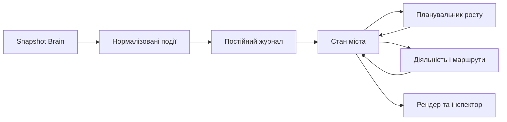

# Brain City · правила симуляції v1

Прийнята основа подальшої розробки від 2026-10-24 на прохання користувача; джерела й аргументація — [URBANISM.md](URBANISM.md).

**Статус:** специфікація майбутньої симуляції; виконання кожного правила потрібно підтверджувати реалізацією і перевіркою, а не наявністю цього документа.

## Пріоритети

Загальна бібліотека (2026-10-25): матеріали поза проєктами мають `knowledge_scope: library` та власні записи в `_global/library/`. Корпуси `grand-library` спільні, з обмеженою місткістю й ресурсами; ID, URI та адреси кожного матеріалу сталі. Проєктні документи й глобальні правила не перепризначаються бібліотеці. Перевірки власності й адрес — `test_library.py`, каталогу та першоджерел — `test_render_layer.js`; схема — CLASSIFICATION.md.

Нижчий пріоритет не може порушити вищий; пряма вказівка користувача має пріоритет над цими проєктними правилами.

## A. Дані, адреси та простір

| ID | Обов’язкове правило | Критерій приймання |
|---|---|---|
| BC-01 | Brain є джерелом нотаток; місто зберігає власний стан окремо від vault | Симуляція не редагує нотатки й `.obsidian/`; фікстура vault до/після ідентична |
| BC-02 | Кожна доступна нотатка має одну адресу: окремий будинок або квартиру; мешканці знань лишаються 1:1 з нотатками | Фізичні будівлі й адресні одиниці рахуються окремо; спільний будинок дозволяє вибрати кожну квартиру й відкрити правильний файл |
| BC-03 | Декоративні й службові об’єкти мають позначку `derived`, не створюють фальшивих нотаток чи населення | Їхній інспектор показує функцію та, за потреби, відповідальний hub, без вигаданого file URI |
| BC-04 | Постійний ID ділянки й збережена геометрія важливіші за порядок обходу файлів | Нова нотатка, сортування, перезапуск і зміна FPS не змінюють координати старих ділянок, дерев та центрів |
| BC-05 | Додати версію схеми стану й явну міграцію; перейменування розпізнавати лише за однозначною ідентичністю | Після міграції джерела відкриваються; конфлікти `id` не об’єднують різні файли; за браком даних працює поточний path fallback |
| BC-06 | Земля є спільним безперервним ландшафтом; парки й проходи — зарезервовані території | Ділянки не перекриваються, не висять над порожнечею і не займають захищені коридори; міст не створює окрему платформу району |
| BC-07 | Геометрія вимірюється у визначених світових одиницях, масштаб метрів задається окремо | Довжина маршруту не залежить від zoom; теперішні умовні world units не оголошуються фізичними метрами заднім числом |

## B. Поява та розширення міста

| ID | Обов’язкове правило | Критерій приймання |
|---|---|---|
| BC-08 | Осередок має причину: тема / hub, діяльність, зручний доступ або явно обраний план | Для кожного нового центру можна показати причину вибору місця; жодних довільних координат лише з номера класу |
| BC-09 | Для нового будинку перевіряємо infill → допустиму адаптацію → край → новий осередок | Рішення записане в журнал подій з оцінками кандидатів; парк не трактується як вакантна ділянка |
| BC-10 | Попит обмежений кількістю джерел і потребами служб; порожня земля сама по собі не створює місто | Після 100 модельних днів без нових подій кількість основних будинків не зростає без причини |
| BC-11 | Розвиток іде через етапи: резерв ділянки → доступ / мережі → будівництво → використання | Нова нотатка одразу видима й відкрита; етапи мають тривалість; немає недосяжного заселеного будинку |
| BC-12 | Історія зберігається; `mtime` не є достовірною датою спорудження | Використовуються події `firstSeen`, `builtAt`, `renovatedAt`; при імпорті вік невідомий, якщо немає підтверджених даних |
| BC-13 | Ущільнення має локальні межі та ресурси | Надбудова лишається в оболонці ділянки, не перекриває доступ; слова чи degree не породжують нескінченну вежу |
| BC-14 | Новий клас спочатку отримує осередок за масштабом наявних нотаток; нове місто — функціонально окремий центр | Кілька hubs не породжують одразу мегаполіс; окреме місто має зв’язок із регіоном та причину відокремлення |

## C. Вулиці, квартали й рух

| ID | Обов’язкове правило | Критерій приймання |
|---|---|---|
| BC-15 | Зберігати окремо граф знань `K`, просторову мережу `S`, пішохідний граф `P` і службові мережі `U` | Нове wiki-посилання може змінити попит на поїздки, але не створює автоматично дорогу через квартал |
| BC-16 | При розширенні спочатку резервується повний вуличний коридор, потім квартал і ділянки | Перевіряються проїзд, тротуари, повороти, відступи й входи, а не тільки центральна лінія дороги |
| BC-17 | Вулиця має тип і профіль: пішохідна, спільна місцева, районна, бульвар / транзитний коридор | Набір дозволених користувачів, ширина, режим руху й перехрестя відповідають її ролі |
| BC-18 | Кожен активний будинок має вхід і мережевий шлях до публічного простору; перехід через проїзд існує явно | Reachability рахується від входів; агенти не перетинають стіни, паркани чи проїзд у довільній точці |
| BC-19 | Мережа має маршрути вибору; зв’язність через одне дерево ребер — лише початковий каркас | Для основних районних осередків передбачати два незалежні шляхи, якщо це допускає ландшафт; справжні містки-винятки позначаються |
| BC-20 | Геометричний перетин не дорівнює транспортному вузлу | В одному рівні — коректне перехрестя; на різних — міст / тунель; відсутній дозволений поворот не маршрутизується |
| BC-21 | Громадський транспорт вводиться під попит і має обслуговування | Лінія має зупинки, доступ пішки, розклад, місткість, очікування й посадку; жодного декоративного автобуса з вигаданими пасажирами |

## D. Функції, мешканці та міський обмін

| ID | Обов’язкове правило | Критерій приймання |
|---|---|---|
| BC-22 | Клас визначає характер району, а не єдину дозволену функцію | Після достатнього розвитку район містить місця діяльності, щоденні послуги та публічний простір; службові будівлі позначені `derived` |
| BC-23 | Об’єкт має явні функцію, місткість, години роботи та стан | Закритий або повний заклад не приймає відвідувачів понад місткість; причина очікування доступна в діагностиці |
| BC-24 | Мешканець має домашній адресний об’єкт, поточну ціль і ланцюжок занять | Видимі стани: вдома, планує, іде, очікує, перебуває, повертається; не синхронний ping-pong |
| BC-25 | Поїздка має початок, доступний пункт призначення, маршрут і прибуття | Немає телепортації через недоступну ділянку; при розриві мережі — перепланування або зрозуміле очікування |
| BC-26 | Знання й міська поведінка зв’язані прозоро | Посилання та project-належність можуть впливати на вибір цілі; ролі вигадані й не виводять реальні особисті дані зі змісту нотаток |
| BC-27 | Послуги й потоки обмежені потужністю; оновлення міста має витрати | Житло / діяльність, енергія, вода, відходи й ремонт мають окремі баланси; одиниці витрат модельні, не реальні гроші |
| BC-28 | Архів не означає руїну; зникнення файла не запускає каскадне знесення | Архівний об’єкт залишається доступним; `sourceMissing` має окреме відображення, не фальшиве посилання; решта джерел не змінюється |

## E. Природа, зовнішність і комфорт

| ID | Обов’язкове правило | Критерій приймання |
|---|---|---|
| BC-29 | Зелень має місце й роль: вулична тінь, двір, парк, край лісу, дощова зона | Рослини не займають проходи й зупинки; має значення їхня досяжність і розташування, а не лише кількість |
| BC-30 | Дерева й матеріали мають збережений вік; дощ / спека враховують покриття в межах обраного рівня деталізації | Нове дерево відрізняється від дорослого; зміна масштабу або додавання нотатки не замінює весь ліс |
| BC-31 | Архітектура залежить від теми, функції, епохи, ділянки й обмежень | У районі є узгоджена родина форм, а не одна модель або випадкова суміш; орієнтири вибіркові |
| BC-32 | Спершу читається місто й джерела, потім прикраси | Ліс, дахи й декор не перекривають основні входи та взаємодію; передбачені наближення й пошук |
| BC-33 | Стандартний сценарій спокійний: зміни локальні, збої пояснювані, час керований | Немає автоматичних пожеж, покарання за неактивність чи знищення пам’яті; пауза й reduced motion діють на всі видимі процеси |

## F. Час, відтворення й чесність моделі

| ID | Обов’язкове правило | Критерій приймання |
|---|---|---|
| BC-34 | Симуляційний час відокремлений від FPS і реального часу комп’ютера | Однакові seed, стан і події дають однаковий результат; рендер не змінює логіку |
| BC-35 | Нові події застосовуються впорядковано й ідемпотентно | Повторне читання того самого snapshot не дублює будівлю, мешканця або будівельну чергу |
| BC-36 | Ресурси зберігають баланс; агрегування не вигадує агентів | Кількість у станах, візуальній вибірці та підсумках узгоджується; черга не стає від’ємною |
| BC-37 | Кожен коефіцієнт і показник має одиницю, походження та статус | Чітко позначено: дані Brain, рекомендована політика чи умовний параметр; жодної заяви про прогноз реального міста |
| BC-38 | Правило в документації не є доказом готової функції | Реєстр можливостей містить `planned / implemented / verified`, відповідні тести та відомі обмеження |

## G. З’єднання мереж: вулиці, стежки, річки

Додано 2026-10-24 на прохання користувача; дослідження — [URBANISM.md § 10](URBANISM.md).

| ID | Обов’язкове правило | Критерій приймання |
|---|---|---|
| BC-39 | Будь-який дотик ребер на одному рівні — спільний вузол | T-дотик ділить ребро автоматично; аудит не знаходить X-перетину без вузла, вузла всередині ребра чи двох вузлів ближче за допуск |
| BC-40 | Сусідні квартали ділять одну вулицю; квартал вирізається з мережі вулиць | Немає паралельних дублів вулиць; між сусідніми кварталами рівно одне ребро на спільній стороні |
| BC-41 | Вулиці показуються безперервними лініями (strokes) | Сегменти одного типу зливаються, якщо кут відхилення ≤ 45°; рендер малює лінії й вузли, а не обрізки |
| BC-42 | Вулична мережа без глухих кутів; кути вузлів ≥ 75° | Connected node ratio = 1 для вулиць; link-node ratio і непрямота пішохідних маршрутів доступні в аудиті |
| BC-43 | Стежки, набережні й мости приєднуються до тротуарів у вузлах | Кожна стежка має обидва кінці на вузлі пішохідної мережі; набережна досяжна від будь-якого входу |
| BC-44 | Річка — постійне дерево, задане до кварталів | Без циклів і розгалужень униз за течією; порядок Strahler зростає при злитті рівних; ширина залежить від порядку; нова нотатка не змінює русло |
| BC-45 | Коридор річки захищений буфером і набережною | Жодного кварталу, ділянки чи будинку в клітинці води; русло не ближче за буфер до набережної |
| BC-46 | Вода перетинається лише мостом: перпендикулярно, на прямій ділянці, поза злиттям | Кожне ребро вулиці над водою — `bridge`; перекіс ≤ 15°; у клітинці злиття мостів немає; мости не створюють критичного ребра |

Параметри цієї групи (`weld_tolerance`, `stroke_angle`, `min_junction_angle`, `bridge_skew`, `river_*`) — умовний сценарій `calm-knowledge-city-v1`, не норми.

Уточнення BC-39, 2026-10-25: явний геометричний вузол перетину зберігає точні координати старих шляхів і місць відвідувачів. Коротке ребро між таким `exactJunction` і збереженим вузлом дозволене всередині загального `weld_tolerance`; це два різні місця, з’єднані справжнім ребром, а не дублікати однієї координати. Інші близькі нез’єднані вузли аудит і далі відхиляє. Міграція v10 → v11 переносить прогрес поточних поїздок на розділені ребра без зміни фізичного положення; перевірка — `test_crossing_migration_keeps_homes_seats_and_travellers_in_place`.

## H. Європейська форма міста

Додано 2026-10-24 на прохання користувача; дослідження — [URBANISM.md § 11](URBANISM.md). Замінює рівну решітку BC-40 (спільні вулиці лишаються обов’язковими).

| ID | Обов’язкове правило | Критерій приймання |
|---|---|---|
| BC-47 | Місто має центральну площу з ратушею, від якої розходяться радіальні вулиці | Площа захищена, досяжна пішки; ратуша — будинок `global.md` біля площі; за відсутності цієї ноди дозволено позначений `derived` fallback; усі радіали першого кільця починаються на площі |
| BC-48 | Вулиці не утворюють однієї решітки | Орієнтаційний порядок φ (Boeing) ≤ 0,2; кути вузлів при цьому ≥ 75° (BC-42) |
| BC-49 | Квартали — криволінійні сектори між кільцями; розмір росте від центру | Глибина кільця не зменшується назовні; дуга кожного кварталу ≥ `min_block_arc`·(1 − `sector_jitter`); межі секторів визначає BC-57 |
| BC-50 | Кільцевий бульвар на лінії колишньої стіни | Вулиці на колі `wall_ring` мають профіль `boulevard` і алею дерев; радіали за стіною — `district` |
| BC-51 | Периметральна забудова: будинки вздовж вулиць, фасадом до вулиці, повернуті за нею | Будинок у межах своєї ділянки, не на проїзді; вхід з вулиці; двір із проходами всередині |
| BC-52 | Відкрите асиметричне русло в долині, незалежне від міських кілець | Виразні вхід і вихід; міський вигин менше півоберту, без кільцевого поясу; округлені повороти й нерівні береги; мости поперек течії поза поворотами; передмістя досяжне |
| BC-53 | Старе місто має провулки й дрібніші квартали | Частина вулиць усередині стіни — `pedestrian`; глибина кварталів старого міста менша за передмістя |
| BC-54 | Райони класів — сектори навколо спільного ядра, а не окремі решітки | Новий клас отримує осередок на межі міста з причиною; спільні вулиці з сусідами інших класів |

## I. Кластери й природна нерегулярність

Додано 2026-10-24 на прохання користувача; дослідження — [URBANISM.md § 12](URBANISM.md).

| ID | Обов’язкове правило | Критерій приймання |
|---|---|---|
| BC-55 | Квартали класу утворюють суцільний кластер | Кожен район має одну компоненту суміжності; допускається зв’язок двох берегів через придатний міст, але не шлях через чужий район; частка сусідів — допоміжний агрегований показник |
| BC-56 | Єдиний стиль кластера | Один архітектурний рід, одна палітра стін і дахів на клас; підкладка кварталів тонована кольором класу |
| BC-57 | Межі секторів у кожному кільці свої; наскрізні лише історичні радіали | Більшість вузлів T-подібні (частка 4-сторонніх ≤ 0,35); глухих кутів 0; кути ≥ 75° |
| BC-58 | Ширини кварталів і ділянок різні | Коефіцієнт варіації дуг кварталів і фасадів ділянок ≥ 0,15; ширини ділянок кратні ¼ одиниці |
| BC-59 | Старе місто має суцільні фасади | Сусідні в ряду будинки старого міста (між ними не вміщується ділянка) мають зазор ≤ 1 м (номінально 0,3 м) і не перекриваються |
| BC-60 | Русло звивисте | Звивистість кожного досягнення ≥ 1,05; русло лишається в захищеному коридорі |
| BC-61 | Кільця хвилясті на кількох масштабах | Максимальне відхилення радіуса кола від середнього ≥ 2,5% і кути вузлів ≥ 75° |

## J. Видимі радіальні кластери й важливий центр

Додано 2026-10-24 на прохання користувача; дослідження — [URBANISM.md § 13](URBANISM.md).

| ID | Обов’язкове правило | Критерій приймання |
|---|---|---|
| BC-62 | Великий проєкт (≥ `neighbourhood_min_sources`) має власний підрайон; малі ділять спільні квартали класу | Будинок великого проєкту стоїть у кварталі свого проєкту; згуртованість підрайонів ≥ 0,5 |
| BC-63 | Квартал має видиму ідентичність | Один архітектурний рід на клас; підрайони — різні відтінки; кольоровий бордюр, тонована земля, двір у стилі класу, плашки назв |
| BC-64 | Клас займає радіальний клин від центру, ширина клину ~ розмір класу на момент планування | ≥ 70% кварталів кожного класу всередині його клину; перевіряти класи окремо; кожен клас доходить до центру; порядок і межі не змінюються від текстової правки чи зміни ваги при незмінному наборі класів |
| BC-65 | Найважливіші джерела стоять ближче до центру | Середнє кільце класів / хабів / найзв’язніших нотаток менше, ніж звичайних; висота забудови спадає від площі |
| BC-66 | Проєкти займають підклини всередині клину класу | ≥ 60% кварталів проєкту в його підклині |

## K. Категоризація й міське управління

Додано 2026-10-24 за прямим запитом користувача; схема й джерела — [CLASSIFICATION.md](CLASSIFICATION.md).

| ID | Обов’язкове правило | Критерій приймання |
|---|---|---|
| BC-67 | Належність, тип матеріалу й міська роль — незалежні виміри | `sourceClass`, найближчий `project`, scope і wiki-зв’язки збережені; `cityDistrict` / `cityRole` визначають просторову проєкцію; локальні правила лишаються зі своїм проєктом; missing/restore зберігає всі виміри |
| BC-68 | Глобальне управління має власний район; основні ноди визначають центри | Одна основна ратуша — будинок `global.md`; правила, реєстри, архів і планування мають власні моделі; центри тематичних районів — class-хаби, за їх відсутності — hub fallback; усі джерельні будівлі відкривають оригінал |

## L. Теми, важливість і спільне житло сесій · 2026-10-25

| ID | Обов’язкове правило | Критерій приймання |
|---|---|---|
| BC-69 | Звичайні сесії живуть у спільних багатоповерхівках свого точного проєкту | До 8 адресних квартир; одна реальна ділянка й фізична будівля, окремі ID / URI / мешканці / ресурси; зникнення чи перейменування файла не перенумеровує квартири |
| BC-70 | Тематичний район визначається явною категорією проєкту, незалежною від організаційного класу | `city_topic` успадковується найближчим підпроєктом; точний owner і `class` збережені; `city_anchor` задає тематичний центр; класи-індекси розміщуються у civic-реєстрі |
| BC-71 | Значущість визначає порядок і тип джерельної забудови; тема — спільні функції | `core / reference / supporting / history`; основні документи — окремі маєтки / корпуси; сесії — компактне житло; спорт має стадіон, наука — кампус на реальних захищених ділянках з входом, місткістю та відвідуваннями |
| BC-72 | Проєкт вбудовується в культову споруду свого кластера, а комплекс росте | Якщо тема має комплекс (стадіон, кампус, технопарк, енергоцентр), проєктна споруда — прибудова цього комплексу: та сама лінія фасаду, спільна пішохідна доріжка від воріт комплексу, тематична функція з `city_subject` (напр. `lubrication` → лабораторія мастил і бульбашок, `sports-technology` → лабораторія спортивної науки). Кожна прибудова розширює комплекс; старий окремий маєток проєкту переходить у прибудову без руху будинків. Нові квартали спершу заповнюють найближчий допустимий пояс навколо комплексу та його прибудов, потім наступний; ширина поясу — 80 логічних метрів (`landmark_growth_band`, параметр сценарію). Усередині поясу діє попередня оцінка компактності. Заповнення вільних ділянок передує новим кварталам; межі району/проєкту, зв’язність, вода й захищені проходи лишаються жорсткими обмеженнями. Якщо ближчий пояс недоступний, обирається найближчий доступний без примусової забудови. Вибір поясу, оцінка й кількість допустимих кандидатів зберігаються в кварталі та події `streetConnected`; існуючі будинки не переселяються. Теми без комплексу лишають окремі проєктні споруди; `city_landmark: none` скасовує споруду |
| BC-73 | Ринок статей — споруда центральної площі | Критий ринок `plaza:market` — найбільший зал зі списку `market_hall_sizes` (34 × 22 … 20 × 12 м, параметр сценарію), що вміщується в площу між її доріжками; менший ринок старого правила один раз перебудовується на тому ж місці площі, відвідувачі зберігаються, не перетинає доріжки, вулиці й будівлі; вхід з’єднаний з центром площі; мешканці всіх районів можуть його відвідати; клік по ринку відкриває панель «Ринок статей» |
| BC-74 | Автобусів стільки, скільки потребує район | Район утримує `round(мешканців / 40)` ліній (`transit_residents_per_bus`, параметр сценарію); нова лінія відкривається лише в межах цього ліміту, зайві раз на хвилину моделі отримують позначку і після останнього рейсу без пасажирів зупиняються (лінія зберігається прихованою й повертається, коли район росте); черга на зупинці йде пішки. Клієнт веде автобус між оновленнями по маршруту, курсу й швидкості з сервера, без стрибків |

Нові теми не замінюють `class`, `domain` і `project`. Значущість — наша відтворювана редакційна модель, не оцінка істинності знань: явне поле `importance` має пріоритет, поточний стан / канонічний огляд вищі за хронологічні записи. `city_anchor` має пріоритет над class-хабом у тематичному поданні, розширюючи BC-68.

План v7 фіксує межі на момент перебудови. Новий клас або зміна набору великих підрайонів — структурна подія, що може змінити поділ; адреси при цьому не переміщуються автоматично. `clusterAudit` показує відхилення й потребу окремої міграції, замість прихованої заяви про відповідність. Нове звичайне джерело й редагування тексту не є перебудовою.

## Стани й події: мінімальний контракт

| Сутність | Мінімальний стан |
|---|---|
| `Source` | stable identity / path fallback, path, class, project, kind, content revision, available |
| `Parcel` | ID, polygon, street frontage, entrance, reserved / vacant / used, protection, history |
| `Building` | source або `derived`, parcel, footprint, envelope, function, capacity, lifecycle, era |
| `Network` | nodes, edges, level, mode permissions, corridor geometry, crossings, capacities |
| `Resident` | source, home, goal, activity, route, progress, schedule seed |
| `Service` | type, reachable area, input/output capacity, schedule, queue, maintenance |
| `Vegetation` | ID, location, species family, plantedAt, growth stage, protected |
| `Event` | ID, revision, logical time, reason, affected entities, schema version |

`sourceAdded`, `sourceUpdated`, `sourceMoved`, `sourceClassChanged`, `sourceMissing`, `sourceRestored` — події джерел; `parcelReserved`, `streetConnected`, `constructionStarted`, `buildingOpened`, `tripStarted`, `tripArrived` — окремі міські події.

## Вибір місця: перевірка перед оцінюванням

| Крок | Рішення |
|---|---|
| 1. Відсікти непридатне | Перекриття, охоронювані землі, відсутність доступу, недостатня оболонка або незабезпечуваний сервіс |
| 2. Оцінити придатне | Семантичне сусідство + доступність + доступні послуги + компактність − ціна підключення − навантаження − порушення спадщини |
| 3. Вибрати стабільно | Збережений seed і стабільний tie-break; без випадковості на кожному кадрі |
| 4. Зарезервувати атомарно | Повторна перевірка конфліктів, резерв ділянки та потужності однією подією |
| 5. Пояснити | Інспектор може показати причину нового будинку, дороги чи центру |

Це наша оцінювальна модель: ваги не запозичені як «закони міста» і мають налаштовуватися сценарієм.

## Стартові параметри · умовний профіль `calm-knowledge-city-v1`

| Параметр | Стартове припущення | Як використовувати |
|---|---|---|
| Довга сторона кварталу | Приблизно 60–140 логічних метрів | Генератор шукає проникність; довший квартал допускається з пішохідним проходом |
| Фасад звичайної ділянки | Приблизно 6–24 логічних метри | Винятки для публічних споруд та об’єднаних ділянок явні |
| Забудова звичайної вулиці | Здебільшого 2–6 поверхів | Вищі осередки потребують локального обґрунтування й потужностей |
| Повсякденна доступність | Ціль 5–15 модельних хвилин пішки | Вимір від входу до входу графом; не гарантія для кожного розміру міста |
| Швидкість ходьби агента | Налаштовувані 0,9–1,6 логічного м/с | Вигадана різноманітність темпу; не атрибут реальної людини |
| Повторюваність вибору | Фіксований seed на сутність і подію | Візуальне тремтіння та глобальна регенерація заборонені |
| Крок логіки | Початково 5 модельних оновлень/с | Прискорення часу явне; будівництво й інфраструктура можуть оновлюватися рідше |
| Відображувані агенти | Окремий бюджет від загального лічильника | Якщо потрібне агрегування, інспектор розрізняє населення знань і видимих агентів |

Це параметри художньої симуляції, **не будівельні нормативи**; конкретні профілі вулиць і частки землекористування ще потребують калібрування.

## Контрольні сценарії

| Сценарій | Очікуваний результат | Пов’язані правила |
|---|---|---|
| +1 нотатка | Один основний об’єкт, без глобального пересування й дублювання | BC-02, 04, 09, 35 |
| +100 нотаток одного проєкту | Кілька кварталів, збережені парки, перевірені підключення; немає накладення районів | BC-06, 08–14, 16 |
| +10 нових класів | Різні осередки з доступом; не однакові платформи на фіксованій решітці | BC-08, 14, 22, 31 |
| +100 wiki-посилань | Оновлений граф знань і, за політикою, попит; без сотні нових проїздів | BC-15, 26 |
| Збільшення тексту в 10 разів | Зміст оновлено, будинок у допустимій оболонці, адреса та доступ збережені | BC-04, 13 |
| Закриття ключової вулиці | Новий маршрут або зрозуміле очікування; коректне повідомлення про ізоляцію | BC-18–20, 25 |
| Повна зупинка транспорту | Пішохідний маршрут, очікування або відмова з причиною; жодної телепортації | BC-21, 25 |
| Повна бібліотека / перевантажена послуга | Черга або інший доступний пункт, без перевищення місткості | BC-23, 27, 36 |
| Архівування / зникнення / повернення файла | Відмінні стани, збережена історія, правильне відкриття після повернення | BC-05, 28 |
| 100 днів без нових джерел | Розклади й догляд тривають; кількість основних будинків не зростає сама | BC-10, 24, 33 |
| 30 проти 60 FPS; save/load | Однаковий логічний результат за тих самих seed і подій | BC-04, 34–36 |
| Зростання 100 → 1 000 → 10 000 джерел | Виміряні час кроку, планування, RAM і кадрів; деградація деталізації явна | BC-32, 34, 36–38 |

## Черга реалізації та визначення готовності

| База станом на 2026-10-24 | Статус щодо повної вимоги v1 |
|---|---|
| Читання vault, нотатка → будинок, відкриття джерела | Реалізовано й перевірялося в першій версії; нові стани будівництва ще `planned` |
| Постійнi slot-адреси | Реалізовано; rename за однозначним ID, збереження сімейства / габаритів і резерв відсутніх джерел перевірено на етапі 0; постійний ландшафт і дерева ще `planned` |
| Суцільна земля, геометрія на поточній фікстурі | Реалізовано й перевірялося; придатність землі та великий ріст ще `planned` |
| Тематична архітектура | Реалізовано; залежність від епохи, функції та ресурсів ще `planned` |
| Вулиці й локальні анімовані мешканці | Реалізовано; граф цільових поїздок, попит і резервні міжрайонні зв’язки ще `planned` |
| Місткості, черги, комунальні баланси, забудова у часі | `planned`; поточний рендер не підтверджує ці механіки |

| Етап | Що додаємо | Умова завершення |
|---|---|---|
| 0. Зафіксувати базу · виконано 2026-10-24 | Версію стану, stable identity, журнал подій, реєстр можливостей | Повторний імпорт, save/load, rename за ID і міграція перевірені без зміни адрес |
| 1. Навчити місто рости | Придатність, постійні ділянки, резерви, infill та край | +100 нотаток проходять геометричні й адресні сценарії |
| 2. Навчити людей жити | Входи, пішохідний граф, цілі, маршрути, перебування | Мешканець доходить до мети й повертається; збої обробляються |
| 3. Додати функціонування | Змішані функції, місткості, послуги, доставки та догляд | Черги, баланси, щоденна доступність пояснювані й перевірені |
| 4. Додати складність | Попит на транзит, інфраструктурні обмеження, історія перебудов | Нові механіки змінюють поведінку, а не лише картинку |
| 5. Відполірувати світ | Епохи, пори року, деталізація площ, регіон із кількома містами | Продуктивність, читабельність і сталі адреси збережені |

До появи нового механізму він позначається `planned`; цей документ не переводить жодну з наявних функцій у `verified` автоматично.

## Впровадження етапу 0 · 2026-10-24

| Механізм | Реалізація та доказ |
|---|---|
| Версійований стан v2 і резервна копія перед міграцією | `city_state.py`; `test_legacy_migration_and_restart`, `test_unknown_or_corrupt_schema_preserved` |
| Стабільний ID; rename лише за однозначним frontmatter ID | `test_rename_and_conflicting_ids`, `test_simultaneous_move_and_replacement_at_old_path`, `test_path_fallback_does_not_guess_rename` |
| Зарезервовані адреси, відсутність і повернення, окремий архів | `test_restore_and_missing`, `test_changed_explicit_identity_keeps_old_memory_separate`; у вікні відсутній файл не має кнопки відкриття |
| Ідемпотентні події, дата спостереження, ревізія вмісту | `test_history_and_idempotence`; повторне сканування та restart не додають подій; зміна `mtime` не вигадує історію |
| Правда джерел і рахунок 1:1 | `test_vault_unchanged`, `test_hundred_sources_and_repeated_snapshots`; 100 нових джерел дають рівно 100 нових адрес, без запису текстів у стан |
| Стабільна архітектурна родина й габарити | `test_city_plan.js`: rename / зміна типу / sourceMissing не змінюють footprint; фактична міграція 142 будинків зберегла координати та моделі |
| Реєстр можливостей | `/api/city` → `cityState.capabilities`: усі BC-01…BC-38, статус, точна область перевірки й тести; повні вимоги поза реалізованою областю залишаються запланованими |
| Видимий результат | Кнопка «Історія», журнал змін, дата першого спостереження й пояснення стану в інспекторі; нативне вікно перевірено |

Цей етап не змінює алгоритм росту, дорожню мережу або поведінку мешканців. Наступний — етап 1: постійні ділянки й обмеження землі, оцінювання infill / краю та перевірка просторового росту на +100 нотаток. Перевірка **адрес** для +100 джерел не означає, що весь цей просторовий сценарій уже пройдено.

## Впровадження групи G і перебудова мапи · 2026-10-24

| Механізм | Реалізація та доказ |
|---|---|
| Спільні вузли й автоматичне розщеплення T-дотиків | `simulation/network.py` (`node`, `edge`, `topology_errors`); `test_touching_edges_share_nodes` |
| Одна вулиця між кварталами | `street_radius` = половина кроку решітки; `test_neighbour_blocks_share_one_street` |
| Безперервні лінії вулиць | `Network.ways()` зливає сегменти при відхиленні ≤ 45°; `test_streets_render_as_continuous_ways` |
| Без глухих кутів, кути ≥ 75° | `Network.metrics()` в аудиті; `test_street_network_has_no_dead_ends_or_sharp_junctions` |
| Набережні й мости приєднані до тротуарів | `World._riverside`; `test_paths_and_promenades_join_sidewalks` |
| Річка-дерево | `World.water`, `World.rivers`: відкрита верхня течія → міський вигин → нижня течія; без вигаданого злиття порядок залишається 1; `test_river_is_a_persistent_tree`, `test_river_course.py` |
| Захищений берег і мости | Клітинки води виключені з росту; фронтир перескакує річку лише мостом; `test_river_corridor_is_protected`, `test_bridges_are_square_and_redundant` |
| Перебудова мапи | `/api/world` → `Simulation.presentation()` → `CityPlan.fromWorld`; рендер малює тротуари й проїзди двома проходами з округленими з’єднаннями; старий світ із іншою решіткою зберігається як `.layout-1.bak` і будується заново |
| Час на мапі | Сервер просуває логічний час на фактичні мілісекунди між запитами, не більше 10 с за раз |

На реальному Brain (143 джерела): 50 ребер вулиць зливаються в 18 безперервних ліній; 0 глухих кутів; connected node ratio 1,0; link-node ratio 2,08. План 10 000 джерел — 4,2 с (раніше 16 с).

## Впровадження групи H: європейське місто · 2026-10-24

| Механізм | Реалізація та доказ |
|---|---|
| Радіально-кільцева сітка | `simulation/world.py`: клітинка = (кільце, сектор); вузли з цілих «тіків» кута, тож спільні вузли збігаються точно |
| Органічна неправильність | `warp()`: хвиляста форма кілець і обмежений вигин радіалів; кути вузлів ≥ 75°, φ ≤ 0,2 (`orientation_order`) |
| Поділ секторів | 6 → 12 → … з T-вузлами, коли дуга задовга, а половини ≥ `min_block_arc` |
| Периметральна забудова | Ділянки вздовж усіх фасадів, будинки повернуті за вулицею; двір відкритий до зовнішньої вулиці й боків |
| Площа, бульвар, провулки | `plaza:town-hall`, профіль `boulevard` на колі 3 з алеєю, `district` для історичних радіалів за стіною, `pedestrian` у старому місті |
| Річкова долина | Верхня течія переходить через округлений асиметричний вигин у нижню; мости поперек течії; старі переходи та зелені маршрути збережені міграцією v8 → v9 |
| Рендер | Повернуті будинки, криволінійні квартали, площа з фонтаном; вузькі ділянки старого міста — будинки з двосхилими дахами |

На реальному Brain: 23 квартали, φ = 0,08 (решітка = 1), 0 глухих кутів. Попередній збережений світ решітки копіюється як `.layout-2.bak` і будується заново.

## Впровадження групи I: кластери й природна нерегулярність · 2026-10-24

| Механізм | Реалізація та доказ |
|---|---|
| Кластери класів | Новий квартал росте поруч зі своїми блоками (`cohesion_weight`), новий клас стартує на боці міста, найдальшому від інших; згуртованість 0,6–0,9 |
| Єдиний стиль | `quarterStyle()` у `web/city-plan.js`: стіни й дах з кольору району, один тип рядових будинків на район, тонована підкладка кварталів |
| Нерегулярні сектори | `boundaries(i)`: свої межі в кожному кільці, нерівні ширини (`sector_jitter`), без тонких секторів; близький розріз продовжує вулицю кільця нижче; частка 4-сторонніх вузлів ≈ 0,2 |
| Ділянки | Ширини кратні ¼ одиниці (8 м у старому місті, 14 м у передмісті); ряди ставляться кроками за реальною довжиною на місцевості; зазор у старому місті 0,3 м |
| Історичні радіали | Наскрізні й нерівно розведені (`historic_swing`) |
| Русло | Радіальні рукави меандрують (`river_meander`), коридор річки не звужується нижче буфера |
| Кільця | Три гармоніки хвилястості (`ring_wobbles`); кути вузлів ≥ 75° |

На реальному Brain: 19 кварталів, φ = 0,07. Попередній світ копіюється як `.layout-3.bak` і будується заново. План 10 000 джерел — 43 с (точніша укладка ділянок); крок логіки 0,009 с.

## Впровадження групи J: радіальні кластери й важливий центр · 2026-10-24

| Механізм | Реалізація та доказ |
|---|---|
| Клини класів | `World.plan_wedges`: порядок за часом заснування, ширина ~ розмір^0,75 з мінімумом; квартал оцінюється відстанню до площі + штрафом за вихід із клину |
| Підклини проєктів | Проєкт ≥ 8 джерел — свій підклин і підрайон; малі проєкти — спільний підклин класу |
| Важливий центр | Класи, хаби й найзв’язніші нотатки поселяються першими й обирають ділянки ближче до площі; на реальному Brain середнє кільце 1,4 проти 3,0 |
| Видимість | Насиченіші палітри, кольоровий бордюр кварталу, двір у стилі класу, свій тип рядових будинків, відтінки підрайонів, плашки назв районів і підрайонів, висота спадає від площі |

На реальному Brain клини: «Продукти й команди» 160°, «Ігри й творчість» 15°, інші 43–50°; 21 з 22 кварталів у своєму клині. 78 тестів, 66/66 правил; план 10 000 джерел — 41 с.

## Виправлення після перебудови · 2026-10-24

### Перебудова v7: класифікація й управління

| Перевірено | Результат |
|---|---|
| Незалежні виміри BC-67 | Повний каталог Brain: `sourceClass`, exact `project`, scope, `cityDistrict`, `cityRole` |
| Основні ноди BC-68 | `global.md` — ратуша; 5 class-хабів — основи тематичних районів |
| Жива кластеризація | 23/23 квартали у своїх клинах; усі райони / підрайони мають по 1 компоненті; historical assignments 0 |
| Докази | 82 тести; 100 / 1 000 / 10 000 джерел без помилок; JS-планування, native build та UI ратуші / ради |

Повний `clusterAudit` доступний у `/api/preparation`; усі наведені частки перевірено на поточному Brain окремо від synthetic readiness. Міграція layout 6 → 7 одноразова та з backup. Зміни складу класів / набору підрайонів надалі можуть потребувати окремої міграції.

| Проблема | Виправлення | Доказ |
|---|---|---|
| Модельна доба починалася опівночі: майже всі мешканці стояли біля зачинених дверей | Доба стартує о 8:00 (`day_start_hour`); мешканці планують лише відкриті й не переповнені місця | 108 зі 115 видимих мешканців у дорозі; `test_capacity_hours_and_fair_queue` |
| У мешканців удома лишалася причина «чекає на будівництво» | Причина очищається, коли мешканець удома | Стан моделі |
| `/api/city` віддавав застарілий реєстр, де більшість правил «planned» | Сервер підставляє актуальний реєстр із `simulation.rules` | `test_http_reads_and_rejects_foreign_origin` |
| Справжні човники симуляції не малювалися | Їх видає `presentation().vehicles`, рендер малює човник у реальній позиції | 4 лінії на реальному Brain |
| Підпис району відсувався далеко від кварталу | Вільне місце шукається вище й нижче від центру | Знімок вікна |
| Бічні списки перебудовувалися кожні 5 с і збивали наведення | При зміні лише стану світу оновлюється тільки мапа | Перевірка рендера взаємодій |
| Нова нотатка в новому кварталі могла потрапити в квартал іншого проєкту | Розподіл після створення кварталу обмежений підрайоном | `test_projects_form_sub_quarters` |
| Цикл бічних ділянок затирав час моделі, дерева мали від’ємний вік і мапа була порожня | Перейменовано змінні циклу | `test_persistent_greenery_age_rain_and_materials` |

## Збереження, добудова й міграції · 2026-10-25

Місто не будується щоразу: збережений світ лише добудовується новими джерелами (BC-04). Обґрунтування й джерела — `OPTIMIZATION.md` §7.

| Механізм | Як працює | Перевірка |
|---|---|---|
| Окремі файли за частотою змін | `<hash>.simulation-v1.json` — маніфест; частини `world-<sha>` (геометрія, джерела, будинки, знання, бюджет), `live-<sha>` (час, мешканці, транспорт, економіка, погода, черги закладів `world.services`), `events-<sha>`. Назва частини — хеш вмісту: незмінна частина не перезаписується; маніфест перемикається атомарно, потім старі частини видаляються. Старий файл одним шматком читається як є | `test_split_save_migration_keeps_city_and_explicit_rebuild`, `test_save_load_and_idempotent_events` |
| Без журналу поїздок | `tripStarted`, `tripArrived`, `transitDeparted`, `transitArrived` не зберігаються: рух видно в живому стані мешканців. Інші події лишаються, їхні id монотонні | те саме; `test_visit_arrival_dwell_and_return` перевіряє відсутність цих подій |
| Міграції замість перебудови | `simulation/migrations.py`: `MIGRATIONS[N]` переводить стан N → N+1, не рухаючи збудоване; ланцюг застосовується при завантаженні. Якщо кроку немає — копія `.layout-N.bak` і нове місто | те саме |
| Явна перебудова | `python3 city/server.py --rebuild` — копія `.rebuild-<час>.bak` і нове місто | те саме |

На реальному Brain: стан 22 МБ (19,5 МБ — журнал поїздок) → маніфест 4 КБ + геометрія 2,0 МБ (пишеться лише при зміні) + живий стан 0,34 МБ + події 0,2 МБ; 152 будинки й час збереглися без перебудови.
