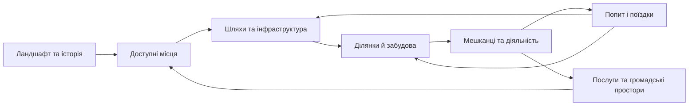
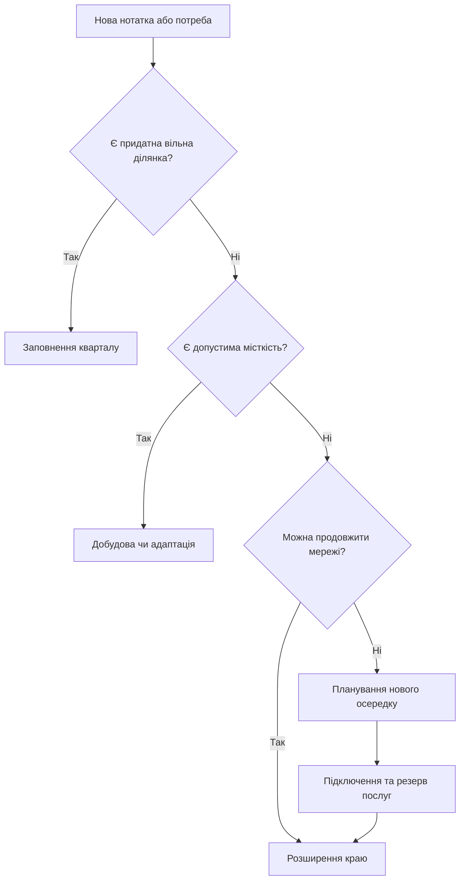
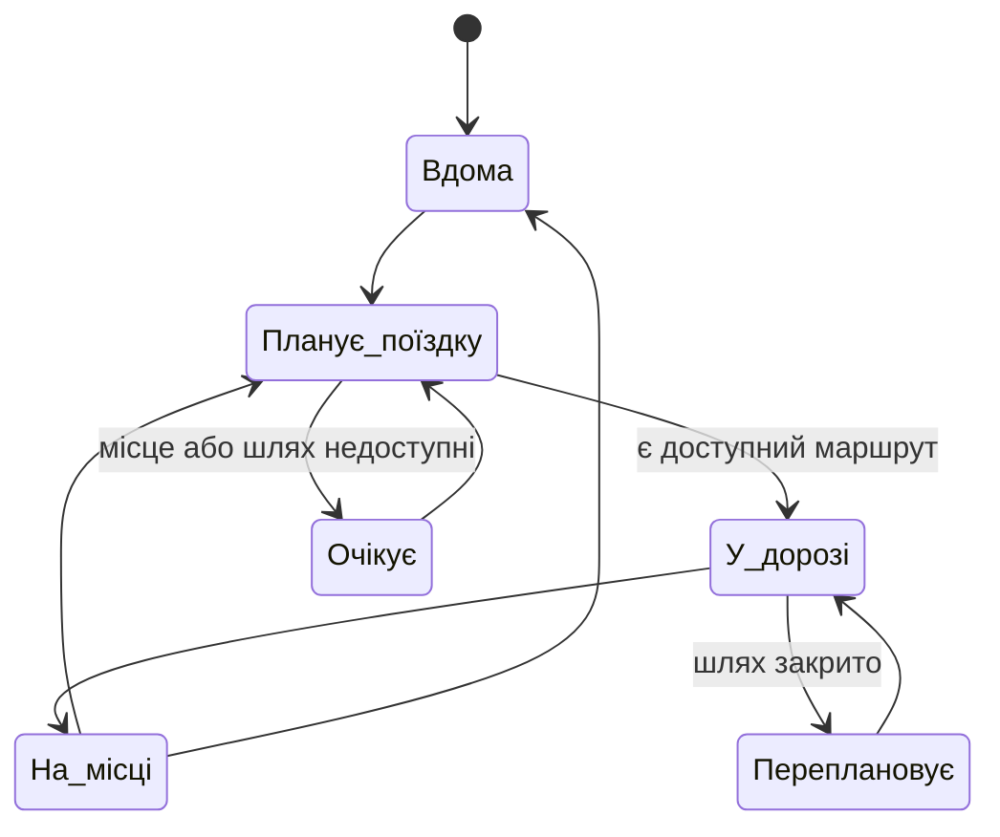
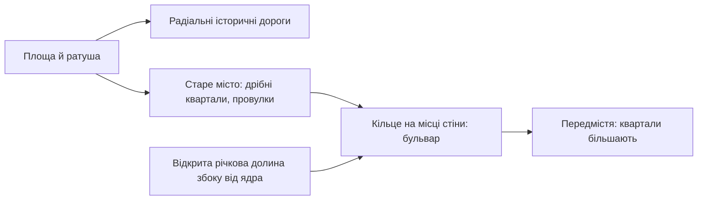
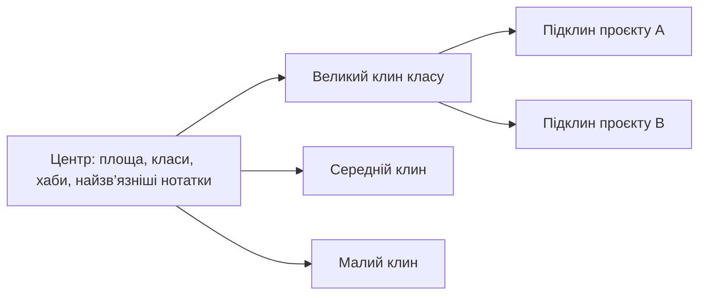

# Brain City · як виникають, розширюються й живуть міста

Дослідження від 2026-10-24; правила реалізації — [SIMULATION-RULES.md](SIMULATION-RULES.md), обов’язковий маршрут роботи — [AGENTS.md](AGENTS.md).

## 1. Місто — система зворотних зв’язків

| Тип твердження | Як читати цей документ |
|---|---|
| **Спостереження** | Історичний випадок або механізм, описаний джерелом; не закон для кожного міста |
| **Рекомендація** | Бажаний напрям планування, наприклад доступність і змішані функції; не опис усіх реальних міст |
| **Модель** | Спрощення дослідницького симулятора; потребує локальних даних і калібрування |
| **Наше рішення** | Обраний спосіб зробити Brain City правдоподібним, читабельним і приємним; конкретизований у правилах |

Жодне з джерел не дає універсального рецепта красивого міста; для Brain City обираємо людиноцентричний сценарій зі збереженням історії й природи.

## 2. Історія залишає геометрію

| Процес / приклад | Що засвідчує джерело | Висновок для симуляції |
|---|---|---|
| Торгове ядро та поступове зростання | DAC описує площі, ринки та нерегулярні вулиці як один історичний тип розвитку [S01] | Початковий осередок, важливі маршрути, дрібні ділянки; нерегулярність має причину |
| Сплановане розширення | Ешампле — запроєктована структура кварталів; пізніше змінювалися щільність, двори та зелені осі [S03] | Старе ядро й нові квартали можуть мати різні геометрії; план і фактична забудова відрізняються |
| Нашарування поколінь | UNESCO включає природні умови, будівлі, інфраструктуру й культурні практики до історичного міського ландшафту [S02] | Вік, перебудови та збережені орієнтири є частиною стану міста |
| Кілька центрів | OECD розглядає поліцентричність на різних територіальних рівнях; результати залежать від масштабу [S14] | Додатковий центр виникає через діяльність і доступність; кільце однакових районів не є універсальною моделлю |

**Візуальний наслідок:** місто повинно показувати свою біографію — збережені старі шляхи, нові продовження, різні покоління будівель, адаптацію ділянок.

## 3. Ріст має кілька режимів

| Режим | Механізм і підстава | Як це має виглядати у Brain City |
|---|---|---|
| Заповнення прогалин | Infill використовує вільні ділянки чи наявну забудову всередині сформованого району [S05] | Новий будинок на підведеній до вулиці ділянці; район не роздувається автоматично |
| Ущільнення | Зміна дозволеної місткості й розвиток нерухомості можуть входити в моделі землекористування [S07] | Добудова або зміна використання в межах ділянки; без безмежного росту від кількості слів |
| Розширення краю | SLEUTH використовує історичну забудову, схили, транспорт і обмеження території [S06] | Продовження наявної вулиці, новий квартал поруч; парк і службові коридори резервуються заздалегідь |
| Ріст уздовж коридору | SLEUTH враховує вплив доріг; землекористування та транспорт взаємодіють у UrbanSim [S06, S07] | Щільніша забудова біля доступного маршруту, а не випадкова смуга будинків |
| Новий осередок | SLEUTH допускає появу нових центрів зростання [S20] | Група пов’язаних нотаток отримує осередок лише за наявності доступу, місця й попиту |
| Повторне використання | Ешампле демонструє трансформацію кварталів і відновлення внутрішніх просторів [S03] | Старий склад може стати майстернею або культурним простором; історія адреси лишається |
| Розосереджений ріст | Модель може відтворювати розповзання, але рекомендації компактного розвитку прагнуть його обмежувати [S04, S20] | Окремий сценарій для порівняння, а не типовий спосіб заповнити мапу |

Цей порядок — **наша компактна політика**, а не твердження, що всі реальні міста розвиваються саме так.

## 4. Вулиці, квартали й ділянки утворюють різні рівні

| Рівень | Досліджений принцип | Правило інтерпретації |
|---|---|---|
| Регіональні зв’язки | Землекористування пов’язане з доступністю робочих місць і послуг [S07] | Далекі зв’язки ведуть між центрами; локальні вулиці обслуговують квартали |
| Вулична мережа | NACTO розрізняє бульвари, місцеві, транзитні та спільні вулиці [S09] | Вулиці відрізняються функцією, профілем і пріоритетом користувачів |
| Пішохідна мережа | ITDP оцінює короткі зв’язні маршрути; SUMO моделює тротуари, переходи та зони перетину [S08, S17] | Шлях рахується від входу мережею; близькість на екрані не доводить доступність |
| Квартал | Процедурна генерація може виділяти квартали з мережі, а потім ділити їх на ділянки [S15] | Спочатку коридор вулиці, потім контур кварталу, ділянки та забудова |
| Ділянка | Геометричні моделі враховують межі, ширини вулиць і будівельні оболонки [S16] | Важливі фасад до вулиці, вхід, двір, відступи та службовий доступ |
| Перехрестя | NACTO розглядає конфлікти руху, геометрію й безпеку як пов’язані рішення [S09] | Перетин ліній ще не створює правильне перехрестя; потрібні вузол, переходи та правила |

**Геометричний контрприклад:** прямі лінії між центрами можуть з’єднати граф, але пройти через будинок, утворити вузьке місце або не дати пішоходу перейти дорогу.

## 5. Район має характер, але містить різні функції

| Система | Що забезпечує | Що потрібно моделювати | Видимий прояв |
|---|---|---|---|
| Житло | Місце проживання | Місткість, заселеність, доступ до послуг | Світло ввечері, двори, балкони |
| Робота та виробництво | Діяльність і обмін | Робочі місця, сумісність, доставки | Офіси, майстерні, склади, службові входи |
| Торгівля й повсякденні послуги | Короткі щоденні відвідини | Доступність, години роботи, пропускна здатність | Крамниці, кафе, активні перші поверхи |
| Освіта й культура | Навчання та зустрічі | Місця, розклади, відвідування | Школи, бібліотеки, театри, кампуси |
| Громадський простір | Перебування й взаємодію | Доступ, заняття, комфорт, догляд | Площа, лавки, тінь, ринок [S10] |
| Вода й водовідведення | Постачання та відведення | З’єднання, потужності, навантаження | Службові споруди, мережевий шар [S19] |
| Енергія та зв’язок | Роботу будівель | Постачання й локальний резерв | Освітлення, підстанції, сонячні дахи [S19] |
| Відходи й обслуговування | Чистоту та справність | Маршрути збору, ремонт, місткість | Сервісні машини, пункти збору [S19] |
| Мобільність | Доступ до можливостей | Пішки, велосипед, транспорт, пересадки | Маршрути, зупинки, рух [S08, S18] |
| Озеленення й дощова вода | Затінення, охолодження, керування стоком | Тип покриття, дерева, накопичення й відведення води | Сади, зелені вулиці, дощові клумби [S11, S12] |
| Реагування на збої | Доступ служб і відновлення | Досяжність та резервні маршрути | Об’їзд, ремонт; це наше доповнення до моделі |

Змішані функції — рекомендація UN-Habitat та ITDP [S04, S08]; з цього не випливає необхідність однакової суміші в кожній будівлі чи кварталі.

## 6. Мешканець діє, маршрут має причину

| Механізм | Що беремо з джерел | Що вирішуємо самі |
|---|---|---|
| Попит і розміщення | UrbanSim пов’язує домогосподарства, робочі місця, забудову й транспорт [S07] | У нас попит походить від структури Brain і простих вигаданих ролей, без профілювання користувача |
| Переміщення | SUMO відокремлює пішохідні шляхи, переходи та взаємодії з транспортом [S17] | Спершу достатньо власного легкого графа; інтеграція SUMO не потрібна для першого етапу |
| Пересадка | SUMO описує вибір видів транспорту, місця пересадок і розклад громадського транспорту [S18] | Автобус має зупинки, час очікування, місткість і пасажирів; його не додаємо лише для декору |
| Життя площі | PPS пов’язує використання простору з доступністю, комфортом і заняттями [S10] | Відвідування, зупинки, зустрічі та ринок змінюються протягом модельного дня |

## 7. Що саме робить симуляцію красивою

| Принцип композиції | Рішення Brain City | Перевірка |
|---|---|---|
| Читабельна історія | Осередок → розширення → нове покоління кварталів | Ранні будівлі й адреси впізнаються після росту |
| Керована різноманітність | Родина матеріалів і форм на район; відмінності фасадів усередині неї | Район пізнається без підпису; будівлі не є клонами |
| Ієрархія силуету | Орієнтир, навколишня забудова, низькі службові елементи | Кожен hub не стає хмарочосом |
| Насиченість на людському рівні | Входи, лавки, вітрини, освітлення, дерева біля реальних маршрутів | Деталі мають функцію й не закривають проходи |
| Динаміка без хаосу | Різні розклади, напрямки й заняття; спокійний темп | Люди не рухаються синхронно; пауза й reduced motion працюють |
| Безперервний ландшафт | Спільна земля, переходи між щільним центром і зеленим краєм | Райони не перетворюються на окремі платформи |
| Локальне оновлення | Новий об’єкт змінює свою ділянку та необхідні мережі | Додавання нотатки не пересаджує весь ліс |

Це наш художній стандарт; дослідження дає підстави для зв’язності та функціональності, а не числову формулу краси.

## 8. Прив’язка до справжнього Brain

| Подія в Brain | Просторовий зміст | Чого вона не доводить |
|---|---|---|
| Новий клас | Запит на район з новим характером | Що вже є населення для великого міста |
| Project-hub | Осередок кварталу й тема діяльності | Що він мусить бути найвищою вежею |
| Нова нотатка | Новий адресний об’єкт і мешканець знань | Реальну кількість людей, сімей або грошей |
| Нове посилання | Семантичний зв’язок і можливий попит на поїздку | Потребу прокласти окрему фізичну дорогу |
| Редагування тексту | Оновлення змісту й обмежена зміна стану будинку | Дозвіл перебудувати район |
| Архівування | Збережена пам’ять та інший режим використання | Руїну або провал проєкту |
| Зникнення файла | Недоступне джерело; окремий стан об’єкта | Дозвіл видалити інші нотатки або вигадати заміну |

## 9. Розрив між теперішньою версією та ціллю

| Уже є у коді | Що ще має з’явитися |
|---|---|
| Суцільна зелена територія та кілька шаблонів планування | Попит, придатність землі й керування ростом замість фіксованих центрів |
| Постійні номери ділянок, квартали та тематичні моделі; на етапі 0 додано версійовану міграцію, ідентичність джерел та історію змін | Постійна геометрія всього ландшафту, придатність ділянок і повний життєвий цикл забудови |
| Геометрично зв’язні вулиці | Повноцінні графи руху, входи, переходи, резервні зв’язки |
| Люди ходять по коротких локальних відрізках | Цілі, розклади, мережеві маршрути, прибуття й перебування |
| Прикраси та озеленення | Функціональні послуги, місткості, догляд, збережений вік дерев |
| Тести геометрії на фікстурі | Сценарії багаторічного росту, відмов, відновлення й продуктивності |

Поточна версія — живий атлас із анімацією; описана тут міська симуляція є наступною ціллю, а не вже реалізованою функцією.

## 10. Як з’єднуються дороги, стежки й річки

Додаткове дослідження від 2026-10-24 на прохання користувача: вулиці на мапі виглядали рваними.

| Що виглядає рваним | Що кажуть джерела | Наше правило |
|---|---|---|
| Дві паралельні вулиці між сусідніми кварталами, з’єднані «драбинкою» | Процедурна генерація ріже сегмент на перетині, приєднує кінець до найближчого перехрестя чи дороги в радіусі [S15]; квартал виділяється з мережі, а не навпаки [S15] | Сусідні квартали мають **одну спільну вулицю**; решітка кварталу є решіткою вулиць |
| Лінії торкаються, але не з’єднані | На одному рівні дороги, що зустрічаються, мають спільний вузол; на різних рівнях — без вузла, з `layer` / `level` [S21, S22] | Кожен дотик на одному рівні — спільний вузол; T-дотик автоматично ділить ребро; X без вузла заборонений |
| Вулиця малюється обрізками | «Природні дороги» (strokes): сегменти зливаються за найменшим кутом відхилення; поріг у дослідженнях 15–60°, 45° — інтуїтивно стабільний [S23, S24] | Рендер малює безперервні лінії зі злиттям сегментів при відхиленні ≤ 45° |
| Глухі кути та кінці «в нікуди» | Connected node ratio > 0,75 бажаний; link-node ratio ≥ 1,4 для пішохідного району; непрямота маршруту ≈ 1,5 прийнятна [S25] | Вулична мережа без глухих кутів; показники рахуються в аудиті |
| Косі вузли | Перехрестя якомога ближче до 90° і компактні [S26]; інші довідники допускають не менше 75° | У вузлах вулиць кут ≥ 75° |
| Стежки обриваються | Пішохідна мережа — тротуари, переходи й шляхи, з’єднані у вузлах [S17, S25] | Стежки й набережні закінчуються на вузлі тротуару чи переходу |
| Ріка як окрема смуга без логіки | Річкова мережа — дерево: притоки зливаються вниз за течією, порядок Strahler зростає при злитті двох рівних [S27]; рельєф і річки можна будувати від дренажної мережі [S28] | Річка задана до кварталів, без циклів і розгалужень; ширина за порядком |
| Будинки на березі | Прибережний буфер: від ~25 футів в урбанізованій прибережній зоні до 100+ футів; ширину задає місцеве правило [S29] | Захищений коридор річки з набережною; кварталів у ньому немає |
| Дороги перетинають воду де завгодно | Дорога перетинає воду мостом [S15]; вісь переходу — перпендикулярно течії, на прямій ділянці, не в закруті [S30, S31] | Лише мости, перпендикулярно, поза злиттям; русло в місці мосту без кута |

**Межа висновків:** джерела описують реальні мережі й інженерні рекомендації; кути, ширини та буфер нижче — параметри нашого стилізованого сценарію, а не норми проєктування.

## 11. Європейське місто замість решітки

Дослідження від 2026-10-24 на прохання користувача: місто з однакових квадратів не схоже на європейське.

| Ознака | Що кажуть джерела | Наше правило |
|---|---|---|
| Орієнтація вулиць | У 100 містах: орієнтаційний порядок міст США / Канади майже в 13 разів вищий, ніж у європейських; європейські вулиці на 42% звивистіші [S32] | Вулиці не однієї решітки: ентропія напрямків висока, порядок φ ≤ 0,2 |
| Структура руху | «Деформоване колесо»: найінтегрованіші вулиці ведуть від центру до краю; з часом вони вирівнюються й ширшають [S33] | Радіальні історичні дороги від площі назовні; за стіною вони ширші |
| Площі | Sitte: замкнені площі, нерегулярні вулиці, змінні перспективи; вулиці входять у площу з різних боків [S34] | Центральна замкнена площа з ратушею біля краю; вулиці сходяться до неї з усіх боків |
| Стіни й пояс | Fringe belt: на краю міста в період застою лишається відкритий пояс — парки, установи [S35]; Рінгштрасе Відня прокладено на місці знесених стін з 1857 [S36] | Кільцевий бульвар з алеєю на лінії колишньої стіни |
| План-одиниці | Частина міста одного періоду має свою єдність вулиць, ділянок і будівель [S35] | Старе місто, бульвар і передмістя мають різну глибину кварталів і профілі вулиць |
| Річка | Старе місто Берна стоїть на пагорбі, який Aare оточує з трьох боків [S37] | Один з можливих історичних випадків; поточне рішення — відкрита долина з асиметричним вигином, див. §14 |
| Квартали | Старі міста росли нарощуванням, тому рівних прямокутних кварталів мало [S38] | Квартали — криволінійні сектори; ближче до центру менші; сектор ділиться навпіл, коли дуга задовга |

**Межа висновків:** це узагальнений тип історичного середньо- та західноєвропейського міста; реальні міста різні (Берн, наприклад, має поздовжній план). Радіально-кільцева схема — наш обраний сценарій, а не єдина «європейська» форма.

## 12. Чому місто виглядало штучним

Дослідження від 2026-10-24 на прохання користувача: потрібні виразні кластери й живий, «реальний» хаос.

| Що видавало штучність | Що кажуть джерела | Наше правило |
|---|---|---|
| Райони перемішані, межі не читаються | Lynch: район — помітна частина міста зі спільним характером (архітектура, використання, щільність), у яку «входиш» [S39] | Квартали класу — суцільний кластер; єдина палітра, дахи й типи будинків; межі по вулицях і річці |
| Ідеальні кільця з рівними секторами | Мережа росте двома процесами: ущільнення навколо наявних центрів і «розвідка» нових доріг на краю; історичні дороги стабільні й утворюють каркас [S40] | Наскрізні лише історичні радіали; решта меж секторів у кожному кільці своя, тож вузли переважно T-подібні |
| Однакові ділянки й зазори | Ширини бургових ділянок різні — групи, що відрізняються на чверть одиниці; у старих містах ділянки 6–7 м [S41] | Ширина ділянки змінна (крок ¼ одиниці); у старому місті фасади суцільні, без зазорів |
| Пряма або циркульна річка | Звивистість = довжина русла / довжина долини; ≥ 1,5 — меандрова, 1,05–1,5 — звивиста [S42] | Русло звивисте: коефіцієнт ≥ 1,05 у межах захищеного коридору |
| Ідеально рівні кільця | Європейські мережі мають вищу ентропію напрямків і на ~42% більшу звивистість маршрутів [S32] | Багаточастотна хвилястість кілець без гострих кутів |

**Межа висновків:** «хаос» тут — контрольована нерегулярність з правилами (сталі вузли, без гострих кутів і перекриттів), а не випадковий шум на кожному кадрі.

## 13. Кластери як радіальні клини й важливий центр

Дослідження від 2026-10-24 на прохання користувача: кластери мають бути видимими, нерівними радіальними частинами, а центр — найважливішим.

| Модель | Що описує джерело | Наше правило |
|---|---|---|
| Концентричні зони (Burgess, 1920-ті) | Діловий центр у середині, далі кільця з іншим використанням [S43] | Центр — найважливіші джерела; висота забудови спадає від площі |
| Сектори (Hoyt, 1939) | Однорідні клини розходяться від центру вздовж транспортних променів і зберігають характер при рості [S43] | Клас займає радіальний клин від площі; ширина клину пропорційна розміру класу, тож клини нерівні |
| Кілька ядер (Harris & Ullman, 1945) | Місто має кілька осередків діяльності [S43] | Великі проєкти — підклини з власним підписом і відтінком усередині клину класу |
| План-одиниці й морфотопи (Conzen) | Менші однорідні частини всередині більшої план-одиниці [S35] | Підрайон проєкту — менша однорідна частина кварталу класу |
| Райони й межі (Lynch) | Район читається за характером і межами [S39] | Кольоровий бордюр, тонована земля, свій тип будинків і двору, плашка з назвою |

**Межа висновків:** це класичні описові моделі переважно американських міст 1920–1940-х; ми використовуємо їх як композиційну схему, а не як закон розміщення.

## 14. Відкрита річкова долина · уточнення 2026-10-25

**Дослідження.** Прага розвивалася на обох берегах Влтави [S44]; Ліон — біля злиття Рони й Сони [S45]. Берн у великому вигині Ааре [S37] є коректним окремим прикладом, але не підставою оточувати кожне місто геометричною дугою 240°. За NPS, меандр — звивисте русло в долині, з розмивом зовнішнього берега й накопиченням матеріалу на внутрішньому [S46]. План міста має враховувати річку, а не задавати їй форму своїм кільцем.

**Наше рішення.** Один відкритий водотік: верхня течія → асиметричний міський вигин → нижня течія. Вхід і вихід лежать на різних сторонах долини; вигин займає менше півоберту, має округлені переходи й змінний відступ. Береги відрізняються шириною та формою. Нових приток для декоративної симетрії не додаємо; без злиття порядок Strahler залишається 1. Радіальні клітинки — внутрішнє обмеження поточного планувальника, а не твердження про природну гідрологію.

**Міграція v8 → v9.** Залишена частина старого захищеного водного коридору, тому будинки, ділянки, вузли, ребра та поточні маршрути не пересуваються. Довгу кільцеву ділянку й зайвий рукав прибрано з водної моделі; їхні наявні переходи стають звичайними дорогами, берегові доріжки — зеленими маршрутами. Старий коридор захищений від забудови, а його дорожні переходи зберігають зв’язність районів. Для нових світів долина резервується до кварталів; зміна нотатки русло не змінює.

Розміри, 120° між напрямками, відступ до 8 м та округлення 20 м — параметри цього сценарію. Це геометрична модель русла, без розрахунку рельєфу, витрати води, повеней чи перенесення наносів.

## Джерела · 46 позицій

Усі посилання перевірені пошуком або відкриттям 2026-10-24; давність публікації не прирівнюється до дати сканування пошуку.

| ID | Первинне / інституційне джерело | Для чого використане |
|---|---|---|
| S01 | [Danish Architecture Center, 2019](https://dac.dk/en/magazine/organic-vs-geometric-city-two-ideals-in-urban-planning) | Історичні типи органічного та геометричного планування; огляд, не універсальна історія всіх міст |
| S02 | [UNESCO, рекомендація про історичний міський ландшафт, 2011, §8–13](https://whc.unesco.org/document/160163) | Нашарування, природні умови, інфраструктура й міська ідентичність |
| S03 | [Generalitat de Catalunya, Cerdà, розділи про Ешампле й відновлення дворів](https://empresa.gencat.cat/web/.content/20_-_turisme/publicacions/documents/arxius/Cerda_en.pdf) | Історія запланованого розширення та подальших перетворень |
| S04 | [UN-Habitat, Five Principles, 2014](https://unhabitat.org/five-principles-of-neighbourhood-design) | Рекомендації компактності, змішаності й зв’язності; використано індексований опис, пряме відкриття повернуло 403 |
| S05 | [US EPA, Infill Development, дослідження 2007](https://www.epa.gov/smartgrowth/measuring-air-quality-and-transportation-impacts-infill-development) | Заповнення сформованої забудови та транспортні зв’язки |
| S06 | [USGS, Forecasting Land-Cover Change, 2014](https://pubs.usgs.gov/of/2014/1125/pdf/ofr2014-1125.pdf) | Входи SLEUTH, історична забудова й обмеження придатності територій |
| S07 | [UrbanSim, документація моделі](https://cloud.urbansim.com/docs/general/documentation/urbansim.html) | Взаємодія землекористування, доступності й рішень агентів; необхідність калібрування |
| S08 | [ITDP, TOD Standard Framework](https://tod.itdp.org/tod-standard/tod-standard-framework.html) | Пішохідна доступність, проникність кварталів, суміш функцій і транспорт |
| S09 | [NACTO, Urban Street Design Guide](https://nacto.org/publication/urban-street-design-guide/) | Типи вулиць, тротуари, перехрестя, пріоритети руху |
| S10 | [Project for Public Spaces, What Makes a Successful Place?](https://www.pps.org/article/grplacefeat) | Доступність, заняття, комфорт і соціальна взаємодія |
| S11 | [US EPA, Green and Gray Infrastructure](https://www.epa.gov/water-research/green-and-gray-infrastructure-research) | Дощова вода, покриття, природна й технічна інфраструктура |
| S12 | [US EPA, Reduce Heat Islands](https://www.epa.gov/green-infrastructure/reduce-heat-islands) | Затінення та охолодження озелененням |
| S13 | [US EPA, About Smart Growth](https://www.epa.gov/smartgrowth/about-smart-growth) | Компактність, різні типи житла, характер місця й охорона природи |
| S14 | [OECD, Brezzi & Veneri, 2014](https://www.oecd.org/en/publications/assessing-polycentric-urban-systems-in-the-oecd_5jz5mpdkmvnr-en.html) | Поліцентричні системи, функціональні зв’язки та залежність висновків від масштабу |
| S15 | [Parish & Müller, SIGGRAPH 2001, Procedural Modeling of Cities](https://people.eecs.berkeley.edu/~sequin/CS285/PAPERS/Parish_Muller01.pdf) | Ландшафт → вулиці → квартали → ділянки → будівлі; глобальні цілі й локальні обмеження |
| S16 | [Weber та ін., Eurographics 2009, 4D Cities](https://cgl.ethz.ch/Downloads/Publications/Papers/2009/Web09/Web09.pdf) | Геометрична міська модель, що змінюється в часі |
| S17 | [Eclipse SUMO / DLR, Pedestrians](https://sumo.dlr.de/docs/Simulation/Pedestrians.html) | Пішохідна мережа, переходи, маршрути та взаємодія з транспортом |
| S18 | [Eclipse SUMO / DLR, Intermodal Routing](https://sumo.dlr.de/docs/IntermodalRouting.html) | Послідовності поїздок, розклад і місця пересадок |
| S19 | [UN-Habitat, Basic Services Indicators](https://data.unhabitat.org/pages/f15206280bed42ec9fa7046aa1385cf4) | Категорії води, санітарії, енергії, зв’язку та поводження з відходами; індексований опис, сторінка динамічна |
| S20 | [USDA Forest Service, GTR NRS-190, Box 1](https://www.fs.usda.gov/nrs/pubs/gtr/gtr_nrs190.pdf) | Інституційний опис чотирьох режимів SLEUTH; не використано як обґрунтування універсальних темпів росту |
| S21 | [OpenStreetMap Wiki, Node](https://wiki.openstreetmap.org/wiki/Node) | Спільний вузол для доріг на одному рівні; різні рівні без вузла |
| S22 | [OpenStreetMap Wiki, Junctions](https://wiki.openstreetmap.org/wiki/Junctions) | Просте перехрестя як спільний вузол; подвійні проїзди |
| S23 | [Jiang, Zhao, Yin, 2008, Self-organized Natural Roads](https://arxiv.org/pdf/0804.1630) | Злиття сегментів у природні дороги; чутливість до порогу кута, 45° |
| S24 | [Tripathy et al., 2021, COINS, EPB](https://journals.sagepub.com/doi/10.1177/2399808320967680) | Безперервність і ієрархія вуличних strokes за кутом відхилення |
| S25 | [VTPI, Roadway Connectivity](https://vtpi.org/tdm/tdm116.htm) | Link-node ratio, connected node ratio, непрямота маршруту |
| S26 | [NACTO, Intersection Design Principles](https://nacto.org/publication/urban-street-design-guide/intersection-design-elements/intersection-design-principles/) | Перехрестя близько 90°, компактні вузли |
| S27 | [Dodds & Rothman, 2000, Geometry of River Networks I](https://arxiv.org/pdf/physics/0005047) | Порядок Horton–Strahler, деревоподібні річкові мережі |
| S28 | [Génevaux et al., SIGGRAPH 2013, Terrain Generation Based on Hydrology](https://www.cs.purdue.edu/homes/bbenes/papers/Genevaux13ToG.pdf) | Ієрархічна дренажна мережа як основа ландшафту |
| S29 | [US EPA, Riparian Forested Buffer BMP](https://www.epa.gov/system/files/documents/2021-11/bmp-riparian-forested-buffer.pdf) | Прибережний буфер із зонами; ширина за місцевим правилом |
| S30 | [TxDOT Hydraulic Design Manual, Crossing Profile](https://www.txdot.gov/manuals/des/hyd/chapter-9--bridges/section-3--bridge-hydraulic-considerations/crossing-profile.html) | Вісь дороги перпендикулярно течії, де можливо |
| S31 | [USDA NRCS, Practice Standard 578 Stream Crossing, WI 2023](https://efotg.sc.egov.usda.gov/api/CPSFile/42141/578_WI_CPS_Stream_Crossing_2023) | Перпендикулярний перетин, уникати закрутів |
| S32 | [Boeing, 2019, Urban Spatial Order, Applied Network Science](https://geoffboeing.com/publications/urban-spatial-order-entropy/) | Ентропія й порядок орієнтації вулиць 100 міст; Європа проти США / Канади |
| S33 | [Hillier, Provençal towns, Space Syntax Symposium](https://www.spacesyntax.net/symposia-archive/SSS2/SpSx%202nd%20Symposium%2099%20-2003%20pdf/2nd%20Symposium%20Vol%202%20pdf/47%20Klarqvist%20300.pdf) та [дослідження Algarve за моделлю deformed wheel](https://periodicos.pucpr.br/Urbe/article/view/22219) | Інтеграційне ядро від центру до краю |
| S34 | [Sitte, 1889, City Planning According to Artistic Principles](https://architectuul.com/architecture/city-planning-according-to-artistic-principles) | Замкнені площі, нерегулярні вулиці, «турбінні» площі |
| S35 | [Journal of Urban Morphology, Conzen: plan units, fringe belts](https://journal.urbanform.org/index.php/jum/article/download/4662/3659/12541) | План-одиниці; поясний відкритий простір на колишньому краю |
| S36 | [Habsburger.net, The Ringstrasse era 1857–1914](https://www.habsburger.net/en/events/ringstrasse-era-1857-1914) | Бульвар на місці знесених стін |
| S37 | [UNESCO, Old City of Berne](https://whc.unesco.org/en/list/267/) | Старе місто в петлі річки |
| S38 | [Greater Greater Washington, Why city blocks vary](https://ggwash.org/view/73422/city-blocks-can-vary-widely-have-you-ever-wondered-why) | Нерегулярні квартали старих міст проти рівних решіток; огляд, не первинне джерело |
| S39 | [Lynch, 1960, The Image of the City](https://www.stroom.nl/en/stroom/library/online-catalogue/2364) та [дослідження районів за Flickr, Edinburgh](https://era.ed.ac.uk/handle/1842/39447) | Райони як області спільного характеру |
| S40 | [Strano et al., 2012, Elementary processes governing the evolution of road networks, Scientific Reports](https://arxiv.org/pdf/1203.0300) | Ущільнення й розвідка; стабільний каркас історичних доріг |
| S41 | [Tait, 2008, Burgage plot patterns and dimensions in four Scottish burghs](https://journals.socantscot.org/index.php/psas/article/view/9724) та [Coleman & Smith, 2005](https://journals.socantscot.org/index.php/psas/article/view/9608) | Різні ширини ділянок, групи з кроком ¼ |
| S42 | [Sinuosity, EPFL Graph Search](https://graphsearch.epfl.ch/en/concept/3335767) та [NSF PAR, sinuosity ≥ 1,5](https://par.nsf.gov/servlets/purl/10376082) | Визначення й пороги звивистості русла |
| S43 | [Cognito, The Internal Structure of Cities](https://cognito.org/courses/ap/humangeog/notes/SkxEUmpWVHU/6.5-the-internal-structure-of-cities) та [Progress.org, Sector Model](https://www.progress.org/wiki/sector-model/) | Моделі Burgess, Hoyt, Harris & Ullman; навчальні огляди, не первинні тексти |

| Код | Нове джерело | Висновок |
|---|---|---|
| S44 | [UNESCO, Historic Centre of Prague](https://whc.unesco.org/en/list/616/) | Історичне місто на обох берегах Влтави |
| S45 | [UNESCO, Historic Site of Lyon](https://whc.unesco.org/en/list/872/) | Міська форма біля злиття Рони та Сони |
| S46 | [NPS, Fluvial Features—Meandering Stream](https://www.nps.gov/articles/meandering-stream.htm) | Меандри, асиметричні береги й відклади |

## Межі висновків

### Категоризація знань і управління · 2026-10-24

| Джерело | Висновок для Brain City |
|---|---|
| [W3C SKOS Reference, §8–9](https://www.w3.org/TR/skos-reference/) і [Primer, §2.5, §4.1](https://www.w3.org/TR/skos-primer/) | Відокремлювати ієрархічну належність, асоціативні зв’язки та колекції |
| [Obsidian Properties](https://obsidian.md/help/properties) і [Aliases](https://obsidian.md/help/aliases) | Зберегти канонічну нотатку та додати властивості / назви для інших подань |

Міська роль — окрема проєкція; рада правил не стає новим проєктним власником. Ратуша відкриває `global.md`; class-хаби задають районні осередки; правила окремих проєктів лишаються локальними. Це наш дизайн на основі моделей організації знань, а не емпіричний доказ єдиної правильної структури vault. Деталі — [CLASSIFICATION.md](CLASSIFICATION.md), BC-67…68. Чотири джерела цієї секції доповнюють історичний каталог S01…S43.

| Обмеження | Практичний наслідок |
|---|---|
| Історичні приклади переважно європейські; рекомендації — міжнародні й північноамериканські | Не називати обраний стиль єдиною природною формою міста |
| Рекомендації сталого розвитку не тотожні опису спонтанного росту | Розділяти симульовані тенденції та нашу політику керування |
| Прогностичні моделі потребують даних про реальне місто | Brain City не прогнозує населення, нерухомість чи економіку реального світу |
| Числа в правилах нижче — стартові параметри нашого сценарію | Не подавати їх як будівельні нормативи або доведені універсальні константи |
| Реалістичність має обчислювальну ціну | Спочатку цілі й доступність, потім складні мережі та детальна поведінка |
