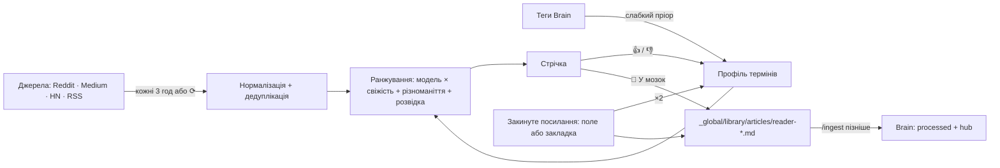

# Brain Reader

Ранкова добірка з Reddit, Medium, Hacker News і будь-яких RSS/Atom плюс посилання, які ти закидаєш сам. Що читати, обираєш сам: сабредіти, теги Medium, RSS і теми. Добірка вчиться з 👍 / 👎 і закинутих посилань, пропонує нові джерела, а одна кнопка кладе статтю в Brain. Акаунтів не підключає: ні паролів, ні токенів. Працює окремо та через ринок у Brain City.

Статус 2026-10-25: етап 1, семантичне ранжування й описи топ-12 реалізовані; 32 тести Reader проходять. Ринок у місті працює як панель і окрема будівля на центральній площі. Нові статті зберігаються в `_global/library/articles/` з `type: article`, `domain: general`, `importance: reference`, без поля `project`; наявний каталог бібліотеки отримує посилання. Старі записи не переміщуються; решта етапу 2 запланована. Раніше перевірено живий збір, пошук пропозицій, закидання посилань і модель вбудовувань; це історичні перевірки, а не новий прогін зовнішніх сервісів.

## Дослідження джерел · перевірено 2026-10-25

| Джерело | Як читати | Ключ / OAuth | Обмеження | Наш вибір |
|---|---|---|---|---|
| Reddit | `reddit.com/r/<a>+<b>+…/top/.rss?t=day&limit=100` (Atom, multireddit) | Ні | `.json` без OAuth повертає **403**; анонімний RSS фактично дає ~1 запит на хвилину (`x-ratelimit-remaining: 0` після першого, далі 429; наша перевірка). Офіційно free tier — 100 запитів/хв на OAuth-клієнт, 10 без OAuth ([оголошення 2023](https://reddit.rtrace.io/r/redditdev/comments/13wsiks/api_update_enterprise_level_tier_for_large_scale/jmnmq38)) | Один multireddit-запит на оновлення; статті розкладаються по сабредітах за `category`; на 429 — один повтор після `x-ratelimit-reset` (до 65 с) |
| Medium | `medium.com/feed/@user`, `/feed/<publication>`, `/feed/tag/<tag>` | Ні | ~10 останніх статей; платні статті без повного тексту ([Medium Help](https://help.medium.com/hc/en-us/articles/214874118-Stats)); у tag-фідах лише анонс; сторінка статті для скрипта повертає **403**; публічного API для читання немає | RSS; для збереження — повний текст із фіду, якщо він довший за витягнуту сторінку |
| Hacker News | `hn.algolia.com/api/v1/search?tags=front_page` | Ні | Публічний JSON | Algolia API |
| Будь-який блог, Substack, dev.to, arXiv | RSS/Atom URL (`…/feed`, `dev.to/feed/tag/<tag>`, `rss.arxiv.org/rss/cs.CV`) | Ні | Залежить від сайту | Тип `rss` |
| X / LinkedIn / Telegram | — | Платний API / закритий / бот або MTProto | — | Не робимо |
| Пошук сабредітів | `reddit.com/subreddits/search.rss?q=<фраза>` | Ні | Запит з `OR` повертає порожньо, одна фраза працює; той самий ліміт ~1 запит/хв | 2 запити на один пошук пропозицій |
| Історія браузера | Chrome `History` SQLite | Локально | Приватні дані | Можливо, на етапі 2 як джерело інтересів, лише після явного дозволу |

TLS: python.org-збірка Python на macOS може не мати CA-сертифікатів; тоді reader бере системний `/etc/ssl/cert.pem`, перевірка сертифікатів лишається увімкненою.

Висновок: RSS покриває всі цільові джерела без ключів і без сторонніх пакетів. Reddit OAuth потрібен лише для коментарів і рахунку голосів; поки не плануємо.

## Вибір користувача

| Що | Як діє |
|---|---|
| Джерела | Перший запуск відкриває «Теми й джерела»: каталог (`sources.json`, 8 тем) з галочками плюс свої сабредіти, `tag/<tag>` / `@user` / publication Medium, будь-який RSS. Без вибору нічого не завантажується |
| Цікаві теми | Слова й фрази; кожне слово отримує фіксовану вагу +1.5 у профілі, навчання її не стирає |
| Не показувати | Стаття зникає зі стрічки, якщо містить усі слова фрази |
| 👍 / 👎 / 🧠 | Донавчають профіль поверх обраного; «Інтереси» показують ваги й дозволяють «забути» термін |

## Закинуті посилання

Від підключення Gmail, акаунтів Reddit і експорту Medium відмовилися 2026-10-25: посилання, яке ти закинув сам, — найсильніший сигнал, а акаунти вимагали паролів застосунку, токенів і розбору чужої розмітки листів.

| Спосіб | Що робить |
|---|---|
| Поле вгорі «Стрічки» | Reader завантажує сторінку: назва з `og:title` / `<title>`, текст з `<article>` / `<main>`. Якщо сторінка закрита (Medium віддає скрипту 403), у нотатці лишаються посилання й назва зі slug |
| Кнопка-закладка «🧠 В Brain» («Теми й джерела» → перетягни на панель закладок) | Бере виділене або текст сторінки, яку браузер уже показав (до 40 000 символів), тож платна стаття Medium, яку ти бачиш, зберігається повністю. Відкриває вікно `127.0.0.1:8766/add` з даними у фрагменті URL, який не йде на сервер і одразу стирається з адресного рядка; зберігає лише після натискання кнопки, щоб чужий сайт не міг сам щось закинути |

Кожне посилання одразу йде в Brain як `status: inbox`, позначається «ти сам закинув це посилання» і двічі навчає профіль (сильніше за 👍). Повторне посилання не створює другої нотатки. Сабредіт, автор або публікація Medium і сайт закинутого посилання стають кандидатами в «Пропозиції».

## Пропозиції

| Звідки кандидат | Приклад причини |
|---|---|
| Теги й сабредіти вподобаних статей | «тег вподобаних статей» |
| Сабредіт, автор або публікація Medium закинутого посилання | «звідти твоє закинуте посилання» |
| Сайти вподобаних і закинутих статей (автопошук `<link rel="alternate">`) | «сайт вподобаних статей» |
| Пошук сабредітів за твоїми темами та найсильнішими вивченими словами | «пошук Reddit: agents» |

Кандидати чергуються за типом (до 15). Для кожного завантажуються свіжі статті; оцінка — середня ймовірність вподобання трьох найкращих ще не бачених. До 3 таких статей потрапляють у стрічку з позначкою «нове джерело» та кнопкою «＋ Джерело». «Не цікаво» назавжди прибирає кандидата і його неоцінені статті. Живий прогін 2026-10-25: 15 пропозицій (r/AI_Agents, r/aiagents, r/learnmachinelearning, теги Medium opencv / robotics …) за 159 с, здебільшого через очікування ліміту Reddit; трапляються нерелевантні кандидати на кшталт r/ImperialAgents_40K, і їх відсуває вниз лише профіль.

## Як добирати статті

| Підхід | Плюси | Мінуси | Рішення |
|---|---|---|---|
| Ключові слова вручну | Просто | Не вчиться | Ні |
| Профіль термінів: онлайн логістична регресія (варіант Rocchio) | Вчиться з першого кліку, пояснюється термінами, чистий stdlib, нічого не передається назовні | Не розуміє синонімів | **Етап 1** |
| Embeddings: локальна `paraphrase-multilingual-MiniLM-L12-v2` через `fastembed` (ONNX, 384 виміри, 0.22 GB) | Розуміє зміст і синоніми, українська ↔ англійська («Аналітика футболу» ~ «Soccer tactics», косинус 0.67); 240 статей за 0.4 с на M3 Pro; нічого не йде в мережу після завантаження моделі | Пакет поза stdlib, 220 MB моделі | **Реалізовано**, опційно: без `fastembed` — лише терміни |
| Описи LLM (`claude -p --model sonnet`, без інструментів, налаштувань і сесії, структурований JSON) | 3–4 речення українською: про що, що конкретно, кому корисно; чесно каже, коли тексту замало | Текст статей (до 3000 символів) іде в Claude API; ~$0.05 і ~30 с за привіз | **Реалізовано** для 12 найкращих статей, один виклик на привіз, кожна стаття описується один раз; збій — пауза 30 хв, далі анонс із фіду |

Вбудовування — додаткові 384 ознаки в тій самій логістичній регресії, поруч із термінами: 👍 / 👎 / закинуте посилання вчать і їх, тож «схоже за змістом» піднімається без спільних слів. Пріор Brain отримує ще центр змісту заголовків і `summary` нотаток (до 2000), обрані теми — центр змісту фраз. Вектор зберігається в `state.json` як base64 float16 (~1 KB на статтю) і не віддається в API. Якщо модель недоступна (немає пакета або офлайн при першому запуску), reader працює на термінах.

Ранжування: `ймовірність вподобання × свіжість`, далі штраф за повтор джерела, а кожен 5-й слот — **розвідка**: випадкова стаття з нижньої половини. Без розвідки профіль, що тягнеться до центру вподобаного, звужує стрічку до бульбашки ([огляд персоналізованих новин](https://arxiv.org/pdf/2106.08934), [симуляція поляризації](https://arxiv.org/pdf/2301.10926)). Перед першим кліком профіль має слабкий апріорний розподіл з тегів frontmatter у Brain.



## Дані та приватність

| Що | Де |
|---|---|
| Статті, оцінки, профіль, джерела | `~/.cache/brain-reader/state.json`, поза vault |
| Збережена стаття | `<vault>/_global/library/articles/reader-<date>-<slug>.md`, `type: article`, `status: inbox`, `knowledge_scope: library` (у місті — Бібліотека знань) |
| Повний текст Medium | Сторінка статті для скрипта — 403, тож текст береться з RSS автора чи публікації (`medium.com/feed/@user`), де пост повний, якщо він не лише для членів Medium |
| Текст для читання в місті | `GET /api/article?id=` завантажує повний текст один раз і тримає його в `state.json` (`body`, `fullText`); у vault нічого не пише. Brain City показує його в читальні для вподобаних і ринкових статей |
| Модель вбудовувань | `~/.cache/brain-reader/models`, завантажується один раз з Hugging Face |
| Мережа | GET до обраних фідів, пошуку сабредітів, кандидатів у пропозиції та сторінки статті, яку зберігаєш, закидаєш або відкриваєш у читальні міста. Нотатки й профіль нікуди не надсилаються |

Нотатка містить метадані, причини вибору та текст статті, витягнутий найкраще, як вдалося (для платних статей Medium — лише анонс). `/ingest <шлях>` перетворює її на звичайний processed-документ із hub-посиланням.

## Параметри сценарію

Умовні значення, підібрані для одного читача; не дослідницькі норми. Константи — в `reader/model.py` та `reader/reader.py`.

| Параметр | Значення | Чому |
|---|---|---|
| Автооновлення | 3 год | Ранок + обід, не довбати Reddit |
| Свіжість, половина ваги | 36 год | Добова стрічка з невеликим хвостом |
| Розвідка | кожен 5-й слот | ~20% нового проти бульбашки |
| Повтор джерела | ×0.85 за кожну попередню статтю з нього | Один сабредіт не забиває топ |
| Зберігання | 14 днів для неоцінених | Стан не росте безмежно; оцінене живе далі |
| Швидкість навчання | 0.6, L2 0.001 | Помітна зміна після 2–3 кліків |
| Вага вбудовувань | 1.0 (одиничний вектор, як і терміни) | Зміст і слова мають рівний голос; пріор Brain за змістом 0.4, тема 1.5 |
| Причина «схожий зміст» | від 0.25 | Нижче — спільна база, яку отримує кожна стаття |
| Обрана тема | +1.5 на слово | Сильніше за пріор Brain (≤0.4), але 👎 може переважити |

## Етапи

| Етап | Що | Статус |
|---|---|---|
| 1 | Закинуті посилання (поле + закладка), пропозиції нових джерел зі зразками статей, вибір джерел і тем, збирання RSS/HN, стрічка, 👍/👎/сховати, навчання профілю, розвідка, «У мозок», перегляд і «забути» інтересів | Реалізовано |
| 2 | Семантичне ранжування й описи топ-12 через `claude -p` — реалізовано; ранковий launchd, пріор з історії браузера — planned | Частково |
| 3 | Brain City: «Ринок статей» — панель, ринки кварталів і окрема будівля на площі; прилавки за постачальником, «Взяти в мозок» → Бібліотека знань, 👍 / 👎; місто пересилає вибір до reader (`city/market.py`) | Реалізовано |

## Запуск і перевірки

```sh
uv run --with fastembed python3 reader/server.py --open   # http://127.0.0.1:8766, з вбудовуваннями
python3 reader/server.py --open                 # лише терміни
python3 reader/server.py --vault ~/Documents/brain --port 8766
python3 -m unittest discover -s reader/tests -v
```

Клавіші: `j` / `k` — наступна / попередня, `l` — 👍, `d` — 👎, `x` — сховати, `s` — у мозок, `o` — відкрити.
